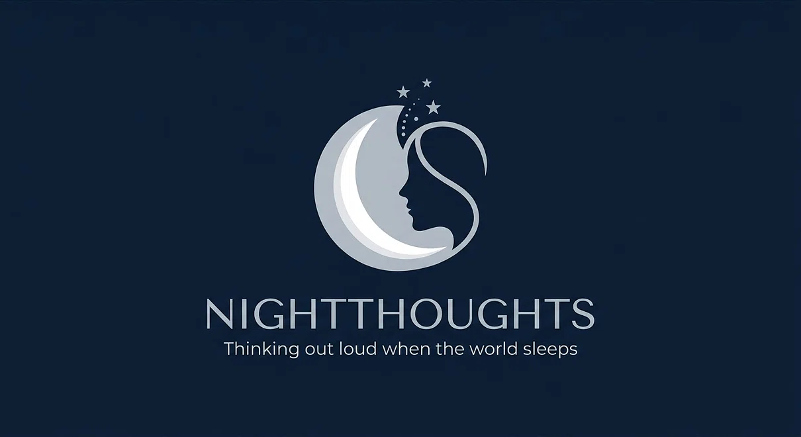

# Night Thoughts

Technical essays and reproducible experiments on local AI, Apple Silicon, agents, and practical software systems.

The main reading experience is at **[nightthoughts.me](https://nightthoughts.me)**.

This repository contains articles and their companion experiments; it is not itself a research-application monorepo.

## Start Here

[Complete Guide: Always-On Mac Server with MLX, oMLX & QwenPaw](https://nightthoughts.me/complete-guide-always-on-mac-server-with-mlx-omlx-qwenpaw)

## What You Will Find

- Local AI: inference, fine-tuning, evaluation, and deployment on Apple Silicon
- Agents: inspectable workflows, persistent services, and failure handling
- Software systems: architecture, implementation notes, and operational trade-offs
- Reproducible experiments: code and evidence supporting selected articles

## Companion Experiments

Companion experiments live under `experiments/`.

Each experiment should contain its own README, exact reproduction commands, evaluation notes, limitations, and attribution.

Do not move or rename Hashnode-generated article files when adding experiments.

## Research Applications

Standalone research applications are maintained in separate repositories and linked from articles when relevant.

## Discussion

Use the comments on nightthoughts.me or open a focused GitHub issue.
