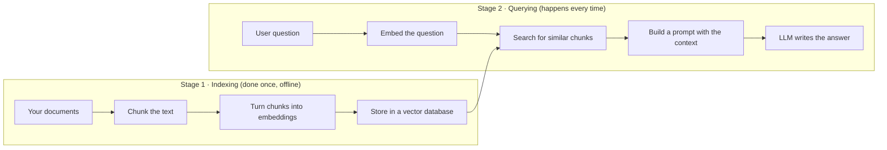

You've probably seen a chatbot confidently answer a question with the wrong company policy, a made-up feature, or a date that hadn't happened yet. That gap — between what a model *knows* and what you actually need it to know — is exactly the problem **Retrieval-Augmented Generation** (RAG) was built to solve.

If you're new to AI, this is the one concept that will make the most sense *and* the one you'll use the most. This guide walks you through it from zero, with plain language, real code, and the diagrams you need to picture how it all fits together.

## What RAG Actually Is

An LLM (large language model) is a very good at-pattern-matching text generator. During training it read a lot of text and stored what it learned inside its internal numbers (called **parameters**). But here's the catch: it only knows what it memorized, and it has no way to look up new information.

Think of it like a very smart student taking a **closed-book exam**. They know a lot, but if you ask about the one policy your company changed last month, they're stuck.

RAG turns that into an **open-book exam**. Before the student answers, you let them open a notebook (your data), find the exact page that matters, and read it out loud. The model's brain doesn't change — but now it has fresh, specific, *your* information in front of it.

That single idea — **retrieve relevant text, then generate an answer using that text** — is the whole technique.

## Why You'd Even Want RAG

There are three reasons RAG has become the default way people build AI apps that need accurate answers:

1. **Freshness.** A model's training data has a cutoff date. RAG can pull in information published *after* that.
2. **Private data.** Your company's internal wiki, your customer tickets, your product docs — none of that was in the model's training. RAG feeds it in on demand.
3. **Trust and accuracy.** When the model answers *based on a passage you can point to*, you get fewer made-up claims (the term for that is **hallucination**) and a way to cite the source.

A quick way to see why RAG beats just stuffing everything into the model:

| Approach | Knows your data? | Stays current? | Can cite a source? | Cost at scale |
|---|---|---|---|---|
| Ask the LLM directly | No | No | No | Low per query |
| Fine-tune the model | Baked in (old) | No, until retrained | Hard | Very high (retrain) |
| **RAG** | Yes, at query time | Yes, update the index | Yes | Low (just search + generate) |

Fine-tuning means retraining the model, which is expensive and slow to update. RAG just means pointing the model at new text, which is fast and cheap to change.

## The Big Picture: Two Stages

Every RAG system has the same two broad stages. You'll prepare your data *once* (offline), then answer questions *repeatedly* (online).



That's it. Everything else in this article is just making each of those boxes work better.

## Stage 1: Turning Documents Into Something Searchable

### Chunking: Cutting the Text

You can't shove a 200-page PDF into a search engine and expect a single answer. So you split your documents into smaller pieces called **chunks**.

There's a trade-off here, and it's the most common place RAG systems go wrong:

- **Too small** → a chunk loses the context around a fact, so the answer feels disconnected.
- **Too large** → the chunk mixes several topics, so it matches nothing well.

A common starting point is 300–800 tokens per chunk with a little overlap (so a sentence split across two chunks still appears in both). You tune it with your own data, not a magic number.

Here's chunking in Python with a popular library, LangChain:

```python
from langchain.text_splitter import RecursiveCharacterTextSplitter

text = """
OpenAI was founded in 2015.
The company focuses on building safe and beneficial AI.
ChatGPT was released in late 2022.
"""

splitter = RecursiveCharacterTextSplitter(
    chunk_size=200,      # max length per chunk
    chunk_overlap=50     # repeat 50 chars across the boundary
)
chunks = splitter.split_text(text)
```

> **Beginner note:** A "token" is roughly a word, but not exactly — it's the unit models count. One token is usually about 4 characters of English. When people say "a chunk of 512 tokens," they mean roughly 400 words.

### Embeddings: Turning Words Into Numbers

Search engines have long matched *exact words*. RAG is different — it matches *meaning*. The trick is **embeddings**.

An embedding is a long list of numbers (a vector) that represents what a piece of text is *about*. The magic: two texts that mean similar things land close together in number-space, even if they share zero words.

"Car" and "automobile" won't match on keywords, but their embeddings sit near each other. That's what makes semantic search possible.

```python
from langchain.embeddings import OllamaEmbeddings  # or OpenAI, etc.

embedder = OllamaEmbeddings(model="nomic-embed-text")

chunk_embeddings = embedder.embed_documents(chunks)
# Each chunk becomes something like [0.02, -0.41, 0.77, ... 768 numbers ...]
```

### The Vector Database

Now you store those number-lists somewhere that can quickly answer: *"which stored vectors are closest to this query vector?"* That's a **vector database**. Popular ones include Pinecone, Weaviate, Qdrant, Chroma, and pgvector.

You don't need to understand their internals to get started — you just add vectors and ask for the nearest neighbors. That's the whole contract.

```python
# Pseudocode: store, then search
db.add(chunks, chunk_embeddings)

# Later, at query time:
query_vec = embedder.embed_query("What is RAG?")
top_hits = db.search(query_vec, k=4)   # 4 most similar chunks
```

## Stage 2: Answering a Question

When a user asks something, you run the second stage:

1. **Embed the question** with the *same* model you used for the chunks.
2. **Search** for the `k` most similar chunks (people often use 3–10).
3. **Build a prompt** that combines the retrieved context with the question.
4. **Send it to the LLM**, which writes an answer grounded in that context.

The prompt assembly is the part that actually matters for quality. Here's the shape of it:

```python
def rag_answer(question, db, embedder, llm, k=4):
    # 1. Search
    hits = db.search(embedder.embed_query(question), k=k)
    context = "\n\n".join([h["text"] for h in hits])

    # 2. Prompt with instructions + context + question
    prompt = f"""
Answer the question using ONLY the context below.
If the answer isn't in the context, say you don't know.

CONTEXT:
{context}

QUESTION:
{question}
"""
    # 3. Generate
    return llm.invoke(prompt)
```

Two things to notice:

- **"Answer using ONLY the context"** — this instruction is what pushes the model to rely on your data instead of its memory, which is how you cut down hallucination.
- **Citing the source** — because each chunk usually carries metadata (document title, page number, URL), you can tell the user *where* the answer came from. That's the trust payoff.

## Where People Get RAG Wrong

Even a "naive" RAG setup that works has a few predictable failure modes. Knowing them now saves you a lot of pain later:

1. **Retrieval noise.** The system pulls in chunks that are *almost* relevant and dilutes the real answer. Fix: rerank the top results, or fetch fewer but better-matched chunks.
2. **Context fragmentation.** The answer lives across two chunks, and no single chunk has all of it. Fix: better chunking, or pull the surrounding paragraph when a chunk is a hit.
3. **Copying a stale tutorial's chunk size.** Old defaults (like 200 characters) are usually too small for modern models. Treat chunk size as a knob to tune, not a constant.
4. **Dropping metadata.** A chunk without a source is an orphan. Keep the document name, section, and page number attached to every chunk from day one.

## Where RAG Is Heading

The basic "retrieve-then-generate" loop is the foundation, but the field keeps adding layers. You don't need any of these to ship a useful system, but they're worth knowing by name:

- **Hybrid retrieval** — combine keyword search (good for exact terms like error codes) with semantic search (good for meaning).
- **Reranking** — a second model re-scores the retrieved chunks and reorders them by true relevance.
- **Agentic RAG** — an LLM "agent" decides *whether* to search, *what* to search for, and *when* to stop, instead of blindly retrieving for every question.

The practical advice: **start with the simplest version that works**, measure how often the answers are right, and only add complexity when you can point to a specific failure the extra step fixes.

## Your First Steps

You can build a working RAG app this week. A reasonable path:

1. Pick one small, boring dataset you actually care about (a product's FAQ is perfect).
2. Use a free or local setup: **Chroma** for the vector store, **Ollama** for embeddings and the LLM, so you don't need API keys to start.
3. Chunk, embed, store, then loop: search → prompt → answer.
4. Test with 20 real questions and read which ones failed. That's your roadmap.

RAG isn't a single trick — it's a pattern. The pattern is: *give the model the right pages before it speaks*. Once that clicks, the rest of the AI stack gets a lot easier to understand.

## Frequently Asked Questions

**Do I need to know machine learning to build RAG?**
No. You're mostly gluing together ready-made pieces — a text splitter, an embedding model, a vector database, and an LLM. The ML is inside the tools you call.

**Is RAG the same as a chatbot?**
No. A chatbot is the *interface*. RAG is a *technique* you can plug into any chatbot (or non-chat app) to make its answers grounded in real data.

**Does RAG remove hallucinations entirely?**
No, but it dramatically reduces them by forcing the model to answer from provided context and by letting you show the source. It's a guardrail, not a guarantee.

**What's a good starting chunk size?**
There's no universal answer, but 300–800 tokens with a small overlap is a common, reasonable place to begin, then tune based on your test questions.

**Do I need a paid vector database?**
Not to learn. Local options like Chroma or pgvector run on your own machine for free. Paid services (Pinecone, Weaviate) shine when you're in production at scale.