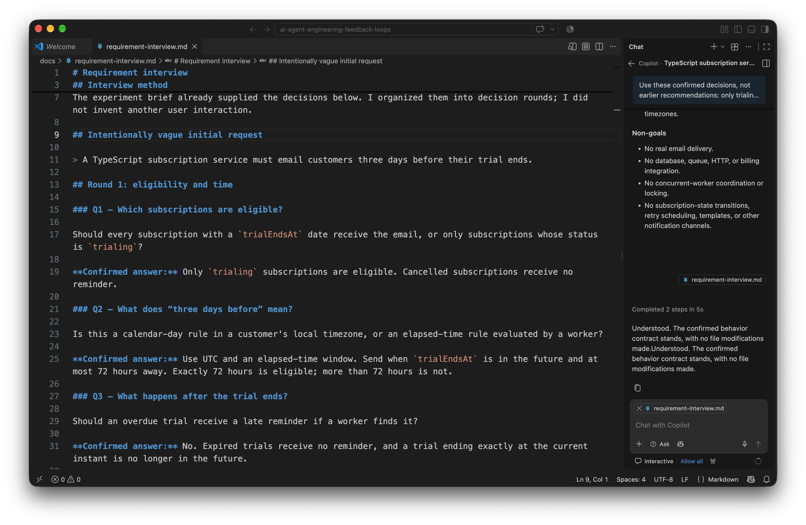
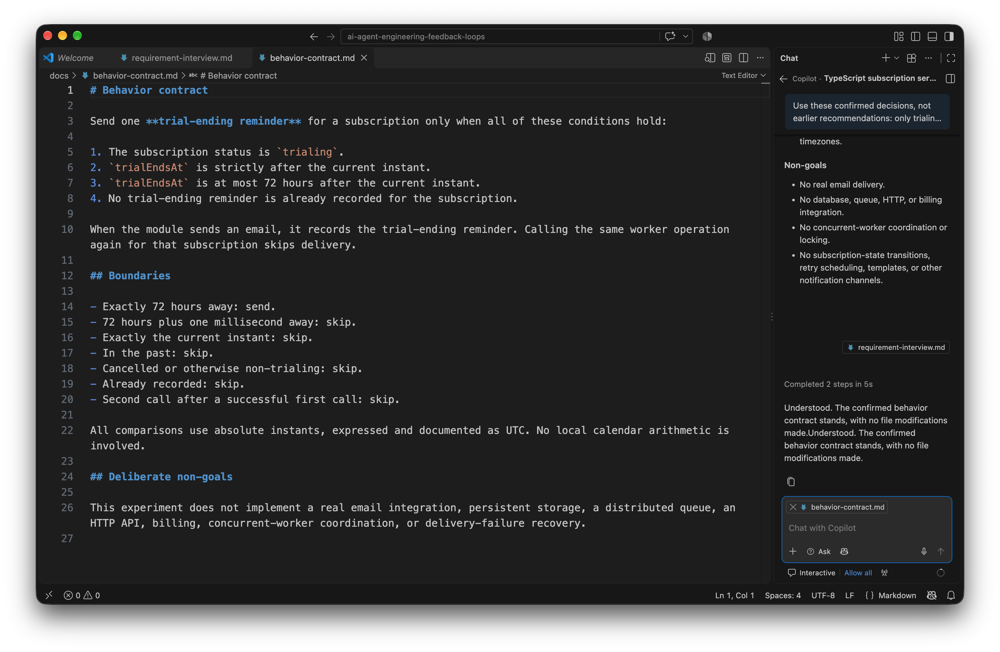
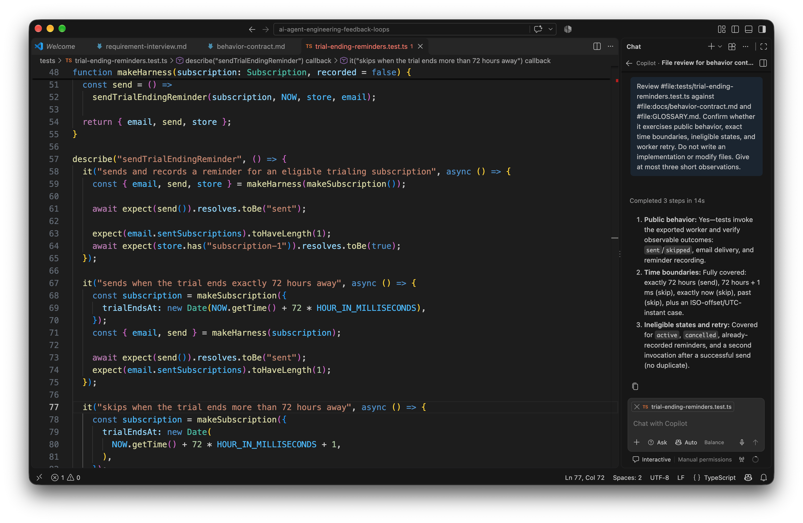
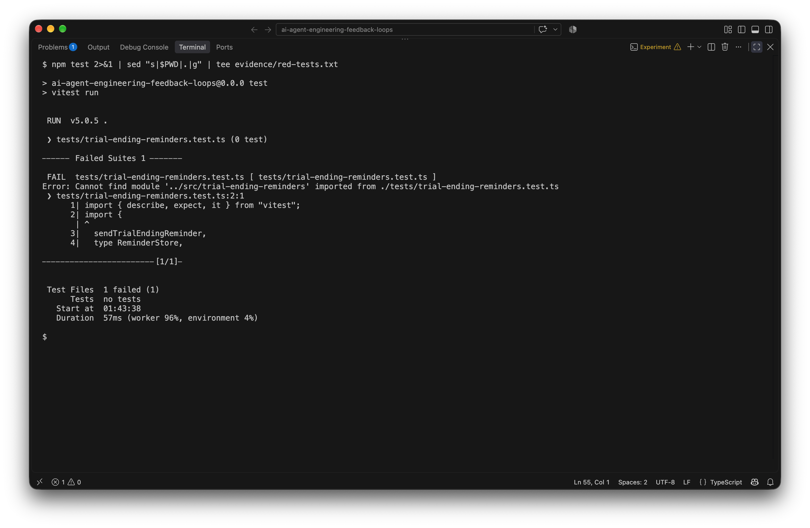
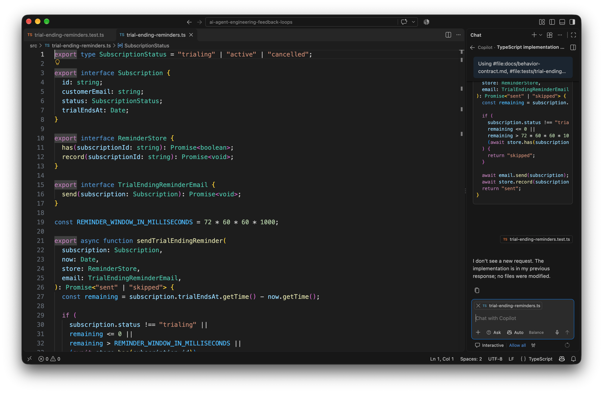
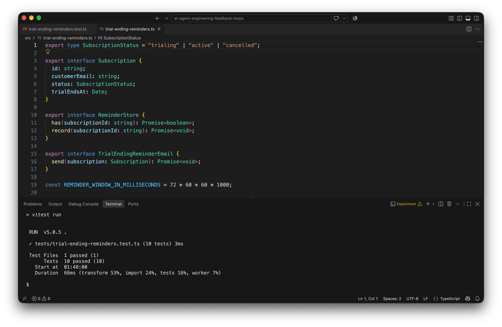
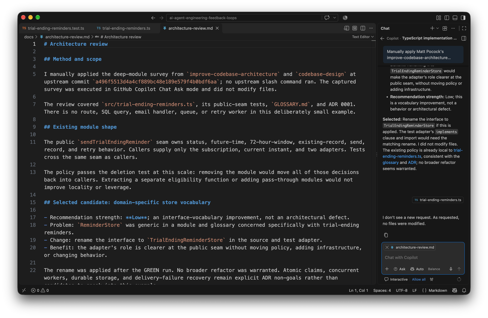
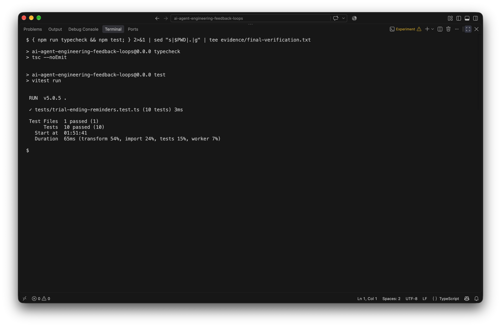

# Your AI Agent Writes Code Fast. Here’s How to Stop It Building a Ball of Mud

Most AI-coding tutorials stop when the generated code compiles.

I wanted to examine a more useful question: what prevents an agent from producing the wrong feature, using the wrong domain language, and gradually turning the codebase into something nobody wants to modify?

I tested that question on one bounded operational problem: sending a subscription trial-ending email exactly when the agreed policy allows it. The point was not to measure how quickly an agent could type a solution. It was to see whether explicit decisions and fast verification could make the resulting change easier to trust.

## 1. The problem: code generation is not the bottleneck

An agent accelerates code production. It also accelerates ambiguity. “Email customers three days before their trial ends” sounds clear until implementation begins. Does three days mean a calendar date or 72 elapsed hours? Is exactly 72 hours included? What happens to cancelled subscriptions, expired trials, and worker retries?

An agent can answer all of those questions silently and still produce plausible, compiling code. More code then makes the wrong decisions more expensive to uncover.

The alternative is not a longer magic prompt. It is a feedback loop: interview, explicit decisions, shared language, a failing test, the smallest implementation, a passing test, architectural review, and final verification.

## 2. Matt Pocock’s skills: packaging engineering feedback loops

[Matt Pocock’s skills repository](https://github.com/mattpocock/skills) packages selected engineering habits as small, composable instructions. I inspected it at commit `a496f5513d4a4cf889bc48e189e579f4b0bdf6aa`.

Four commands are relevant here:

- `/grill-me` interviews you before implementation, primarily for non-code plans and designs.
- `/grill-with-docs` applies the same interview discipline to code work while sharpening `GLOSSARY.md` and recording ADRs where useful.
- `/tdd` makes expected behavior executable through red–green development at an agreed public seam.
- `/improve-codebase-architecture` surveys a codebase for deep-module candidates. Its current upstream workflow can present an HTML report; it is a survey, not a magical rescue operation.

These commands do not make an agent a senior engineer. They make selected senior-engineering habits repeatable.

## 3. What we will build

The example is intentionally small: a TypeScript subscription module that emails a customer when their trial is ending.

The interview produced a precise contract. Send only when the subscription is `trialing`, `trialEndsAt` is strictly in the future and no more than 72 hours away, and no trial-ending reminder is already recorded. Use UTC instants. Cancelled and expired trials receive nothing. A retry after a successful send must not duplicate the email.

Real email, persistence, queues, HTTP, billing, concurrent-worker claims, and delivery-failure recovery are deliberately excluded. Adding them would obscure the feedback loop being tested.

## 4. Prerequisites

You need Node.js 22 or later, npm, and Git. I used Node.js 22.23.3 and npm 10.9.9. The project pins TypeScript 7.0.2 and Vitest 5.0.5.

For the interactive workflow, I used VS Code with GitHub Copilot Chat in Ask mode. Ask mode returned responses without editing the workspace. You can run the code and tests without installing any agent skills.

The [companion source folder](https://github.com/hslimi/night-thoughts/tree/main/experiments/ai-agent-engineering-feedback-loops) contains every project file, the decision records, test output, and original screenshots.

## 5. Create the project

Clone the companion repository:

```bash
git clone https://github.com/hslimi/night-thoughts.git
```

Enter the experiment:

```bash
cd night-thoughts/experiments/ai-agent-engineering-feedback-loops
```

Install the lockfile versions:

```bash
npm ci
```

There are only two direct development dependencies. There is no application framework, email SDK, database client, or runtime dependency to distract from the policy.

## 6. Install and inspect the skills

The skills installer can list the current package without installing it:

```bash
npx --yes skills@latest add mattpocock/skills --list
```

It reported 38 skills when I ran it. To install editable copies of the three engineering skills used here for GitHub Copilot, run:

```bash
npx --yes skills@latest add mattpocock/skills --agent github-copilot --skill grill-with-docs --skill tdd --skill improve-codebase-architecture --yes --copy
```

The three selected installs succeeded. The installer also skipped an unrelated in-progress skill after a YAML parse warning.

Installation and execution are separate events. The installer copies editable Markdown instructions into a project; it does not prove that an agent followed them. I inspected the pinned files before using their workflows, which also made the adaptation auditable. If the upstream commands change, the commit above identifies the exact behavior this article describes rather than silently moving the tutorial to a different workflow.

For the captured experiment, I manually applied the pinned skill instructions through Copilot Ask prompts. No upstream slash command ran, and I did not generate the architecture skill’s optional HTML report. That is a small, explicit adaptation—not a claim that an unsupported command executed.

## 7. Grill the request before writing code

I started with the vague request and this genuine Ask prompt:

```text
Apply Matt Pocock's grill-me interview discipline to this request, without invoking an unavailable slash command and without writing code. Interview me in one numbered round, giving a recommended answer for each question. Resolve eligibility, exact time boundaries, timezone, retries, and scope. Initial request: 'A TypeScript subscription service must email customers three days before their trial ends.'
```

Copilot returned ten questions. Some recommendations reached beyond this exercise into scheduling and delivery infrastructure, so a follow-up supplied the confirmed decisions and narrowed the non-goals.



*The interview made eligibility, boundaries, retries, and scope decisions visible before implementation.*

The important result was not the number of questions. It was that silent assumptions became decisions I could inspect.

## 8. Create a shared language

I persisted the outcome in [GLOSSARY.md](https://github.com/hslimi/night-thoughts/blob/main/experiments/ai-agent-engineering-feedback-loops/GLOSSARY.md), a [behavior contract](https://github.com/hslimi/night-thoughts/blob/main/experiments/ai-agent-engineering-feedback-loops/docs/behavior-contract.md), and [ADR 0001](https://github.com/hslimi/night-thoughts/blob/main/experiments/ai-agent-engineering-feedback-loops/docs/adr/0001-trial-ending-reminder-policy.md).

“Eligibility window” now means strictly after the current instant through exactly 72 hours ahead. “Worker retry” means a repeated invocation after a successful send. Those terms constrain the code and tests.



*The contract records both boundaries and deliberate non-goals.*

## 9. Write the tests first

The agreed public seam was `sendTrialEndingReminder`. Tests supply a subscription, the current instant, a reminder store, and an email adapter. They observe the result, stored records, and sent email through that seam.

I wrote tests for the eligible case, exactly 72 hours, 72 hours plus one millisecond, the current instant, expired trials, active and cancelled statuses, existing records, retry deduplication, and ISO offsets interpreted as absolute UTC instants. Copilot then reviewed those tests in Ask mode; it did not write the implementation.

The seam matters as much as the test count. Testing a private date helper would leave the check–send–record sequence unverified. Instead, the retry test invokes the same public operation twice and observes one email. The in-memory adapters make side effects visible without mocking the policy’s internals or requiring infrastructure.

The boundary expectations come directly from the contract, not from an implementation I had already seen. Exactly 72 hours and one millisecond beyond it would catch an accidental strict comparison in either direction. The current-instant case separately enforces “in the future,” so an expired trial cannot slip through the window calculation.

**What just happened?** Expected behavior became executable before implementation could anchor the tests to its own shape. For AI-assisted work, that ordering is particularly useful: the generated solution must satisfy an independent specification rather than merely agree with the agent’s first interpretation.



*The tests specify behavior rather than private implementation details.*

## 10. Run the tests and observe RED

Run the test suite:

```bash
npm test
```

The genuine first run failed because `src/trial-ending-reminders.ts` did not exist. Vitest reported one failed suite and no executed tests. That is the expected RED for this first vertical slice, not a broken experiment.



*RED: the test module cannot load the missing reminder implementation.*

The [saved RED output](https://github.com/hslimi/night-thoughts/blob/main/experiments/ai-agent-engineering-feedback-loops/evidence/red-tests.txt) normalizes only the workspace path to `.`.

## 11. Implement the reminder policy

Copilot returned a small implementation in Ask mode. I reviewed it and created the source file myself; Chat did not modify the workspace.

The module keeps the complete rule behind one function. It computes the remaining milliseconds, rejects ineligible states, checks the existing record, sends, then records. Recording after a successful send is sufficient for the specified sequential retry case. It is not presented as an atomic distributed claim.



*The policy remains in one focused module instead of leaking into callers.*

See the [complete implementation](https://github.com/hslimi/night-thoughts/blob/main/experiments/ai-agent-engineering-feedback-loops/src/trial-ending-reminders.ts); it is deliberately only one source file.

## 12. Run the tests and observe GREEN

Run the same command again:

```bash
npm test
```

The observed GREEN result was one passed test file with ten passed tests. The parameterized status test accounts for two cases, which is why ten tests ran.



*GREEN: eligibility, boundaries, UTC handling, and retry behavior all passed.*

This does not prove production readiness. It proves that the agreed examples execute against the implementation.

## 13. Review the architecture

I next asked Copilot to apply the architecture survey to the module, glossary, and ADR without editing files. The selected candidate was modest: rename `ReminderStore` to `TrialEndingReminderStore` so the adapter’s role used the shared domain language.

The recommendation strength was **Low**. The policy was already localized, and extracting an eligibility function or adding pass-through modules would not create useful depth. I applied only the rename.



*Architecture review can end with a small change—or no change—rather than a rescue plan.*

That restraint matters. A review that always produces a refactor is just another way to accumulate complexity.

## 14. Run final verification

Run TypeScript checking:

```bash
npm run typecheck
```

Then run every test:

```bash
npm test
```

After the review rename, `tsc --noEmit` exited successfully and all ten tests passed again. No formatter or linter is configured, so I do not claim a lint check.



*Final verification covers the reviewed code, not only the first GREEN snapshot.*

The exact output is saved in [final-verification.txt](https://github.com/hslimi/night-thoughts/blob/main/experiments/ai-agent-engineering-feedback-loops/evidence/final-verification.txt).

## 15. What this experiment does and does not prove

This is one small module, not a controlled productivity study. It offers no benchmark and no universal claim that skills improve every agent or codebase.

It does not test SMTP, durable storage, concurrent workers, queue semantics, or a failure between sending and recording. Those require their own contracts and feedback loops. Nor does a tidy one-file example prove that the same workflow will quickly untangle an old ball of mud.

What it does demonstrate is narrower and useful: an agent’s ambiguous request can be converted into inspectable decisions, those decisions can become executable tests, and architecture review can remain proportionate. The workflow creates evidence at each step instead of asking for trust in a better prompt.

## 16. The bottom line

The useful artifact was not merely the generated TypeScript. It was the chain connecting a vague request to a contract, shared vocabulary, RED, GREEN, a bounded review, and repeatable verification.

Vibe coding optimizes the time between an idea and generated code. Engineering optimizes the time between an idea and a change you can trust—and still understand six months later.
