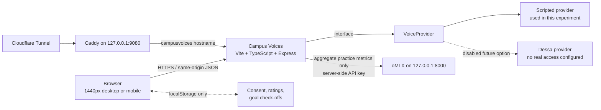

# Campus Voices

Campus Voices is a reproducible Night Thoughts experiment in private, voice-first seminar practice. The “My First Seminar Contribution” scenario gives a student five minutes with a simulated partner and five optional participation goals. It is a scripted prototype: it does not record a voice, transcribe speech, grade performance, or measure learning outcomes.

## Architecture



The browser never receives the oMLX API key. Feedback requests contain only starting confidence, the number and identifiers of self-reported goals, and elapsed practice time. If oMLX is not configured or is unavailable, the server returns clearly labelled scripted feedback.

## Prerequisites

- macOS on Apple Silicon for the reference setup; the application itself is portable Node.js.
- Node.js 22.12 or later and npm.
- A local oMLX endpoint for optional model-generated feedback.
- Caddy and `cloudflared` only for the public hostname.
- Playwright Chromium for browser tests and screenshots: `npx playwright install chromium`.

## Local installation

```bash
cd experiments/campus-voices
npm ci
cp .env.example .env
```

Edit `.env` locally. It is ignored by Git. The application also runs with scripted feedback when the oMLX values are absent.

## Environment configuration

| Variable        | Purpose                                      | Safe default                             |
| --------------- | -------------------------------------------- | ---------------------------------------- |
| `OMLX_BASE_URL` | Server-only OpenAI-compatible local endpoint | `http://localhost:8000/v1`               |
| `OMLX_MODEL`    | Locally available model identifier           | Set after querying `/v1/models`          |
| `OMLX_API_KEY`  | Server-only local credential                 | Never expose through browser code or Git |
| `HOST`          | Application bind address                     | `127.0.0.1`                              |
| `PORT`          | Application port                             | `3000`                                   |
| `PUBLIC_ORIGIN` | Documented public origin                     | `https://campusvoices.nightthoughts.dev` |

## Development and production

```bash
npm run dev
# http://127.0.0.1:3000

npm run build
npm start
```

`npm run dev` starts Express with Vite middleware. `npm run build` checks types, builds the browser assets, and compiles the server. `npm start` serves the production build from `dist/` and the server from `dist-server/`.

## oMLX configuration

List locally available model identifiers without printing the credential:

```bash
curl --fail --silent --show-error \
  -H "Authorization: Bearer ${OMLX_API_KEY}" \
  http://127.0.0.1:8000/v1/models
```

Set `OMLX_MODEL` to one returned identifier. Only `server/feedback.ts` makes oMLX requests. It sends aggregate practice metrics, not audio, transcripts, names, or free-form student text. Scripted feedback remains an intentional offline fallback.

## Caddy and Cloudflare Tunnel

Add only the block in [`infra/Caddyfile.campusvoices.example`](infra/Caddyfile.campusvoices.example) to the existing Caddy configuration, validate it, and reload Caddy with the service manager already in use:

```bash
caddy validate --config infra/Caddyfile.campusvoices.example
```

Follow [`infra/cloudflare-tunnel.md`](infra/cloudflare-tunnel.md) to add the hostname before the tunnel’s catch-all rule and create its DNS route. Do not expose port `8000`. The sanitized launchd example is [`infra/com.nightthoughts.campusvoices.plist.example`](infra/com.nightthoughts.campusvoices.plist.example).

## Tests and verification

```bash
npm run format:check
npm run lint
npm run typecheck
npm test
npx playwright install chromium
npm run test:e2e
npm run build
node scripts/verify-static.mjs
```

The browser scenario covers consent, pre-session confidence, the five-minute timer, the simulated partner, all five goals, early ending, supportive feedback, post-session confidence, and local-data deletion. The static check rejects server credential names and browser speech-capture APIs.

To capture the synthetic demonstration screens against a running production server:

```bash
node scripts/capture.mjs http://127.0.0.1:3000
```

## Privacy and security

- No microphone permission, recording, transcript, or cloud speech service is used by the scripted provider.
- Browser storage contains only consent, confidence ratings, goal identifiers, and a session count.
- The delete-local-data control removes the `campus-voices.local.v1` storage key.
- oMLX stays on localhost; its API key is read only by the server.
- Production responses include a same-origin Content Security Policy and restrictive browser permissions.
- Dessa is represented only as a disabled future provider.
- Use Cloudflare Access during development. Institutional consent and ethics review are required before any student research.

## Limitations

This is a scripted interaction prototype, not a real-time speech-to-speech system or a Dessa integration. Self-selected goals and confidence ratings are reflections, not validated measurements. No student study has been run, no learning outcome has been measured, and the application is not presented as production-ready or research-validated. Real-time latency, interruption handling, accessibility with diverse users, and institutional deployment remain unevaluated.

## Step-by-step guide

Read [`docs/setup-guide.md`](docs/setup-guide.md) for reproduction steps and [`docs/hashnode-draft.md`](docs/hashnode-draft.md) for the companion Night Thoughts article draft.

Source: [Night Thoughts experiments](https://github.com/hslimi/night-thoughts/tree/main/experiments/campus-voices).
