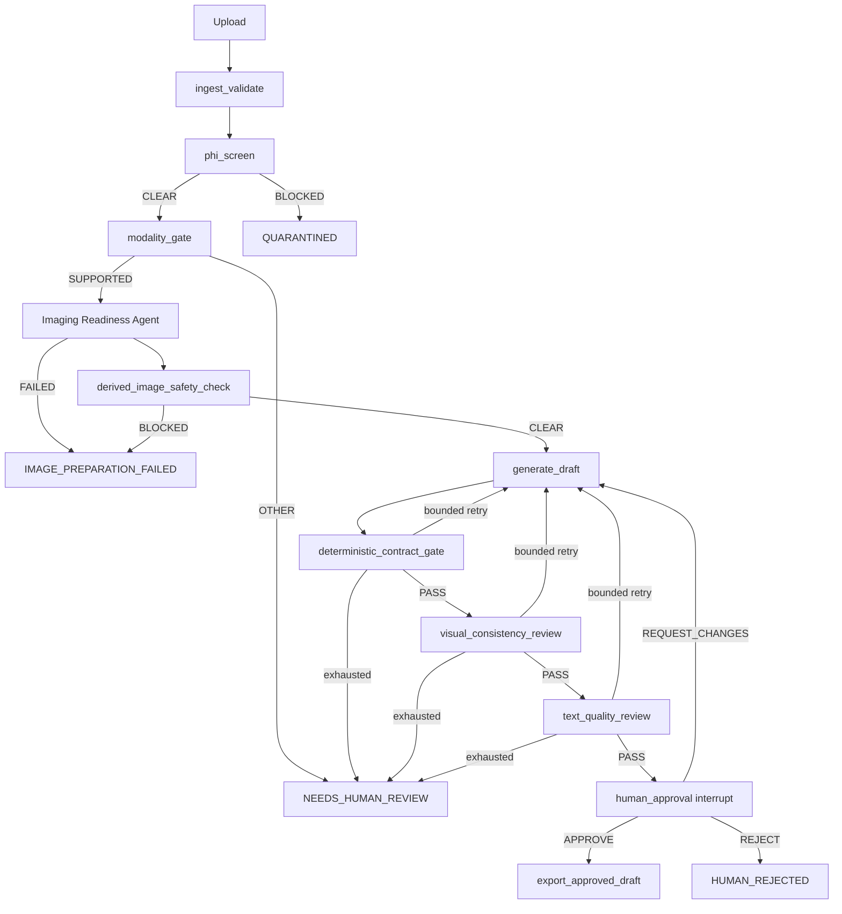

# NT Imaging Workflow

A local-first [Nightthoughts](https://nightthoughts.me) experiment running a LangGraph chest-radiograph drafting workflow with oMLX, deterministic preparation and policy gates, durable SQLite checkpoints, and mandatory doctor review before export.

> **Research demonstration only. Use synthetic or authorized de-identified images. AI-assisted drafts require qualified human review and are not for clinical use.** No diagnostic accuracy, anonymization guarantee, regulatory clearance, or hospital-production readiness is claimed.

## Documentation

- [Architecture](docs/architecture.md)
- [Installation and configuration](docs/installation-and-configuration.md)
- [Doctor and operator user guide](docs/doctor-pipeline-user-guide.md)
- [Imaging Readiness Agent policy](docs/imaging-readiness-policy.md)
- [Security and limitations](docs/security-and-limitations.md)
- [Verification and evidence](docs/verification.md)
- [Durable event and SSE schema](docs/event-schema.md)
- [Debugging and recovery](docs/debugging-guide.md)
- [Account management without restarts](docs/account-management.md)
- [Machine-readable v4 evidence manifest](evidence/manifest-v4.json)
- Blog sources: [installation guide](blog/local-langgraph-installation-guide.md) and [doctor/operator guide](blog/doctor-operator-user-guide.md). The corresponding Hashnode items are private drafts, not publicly published articles.

## Corrected workflow



The **Imaging Readiness Agent** is deterministic code, not an LLM. It applies versioned DICOM/raster preparation, verifies the lossless derivative, re-screens derived pixels, and emits immutable source/derivative lineage. It does not make findings or enhance images. Only its `prepared_artifact_id` reaches drafting.

The export node independently rechecks PHI, modality, readiness, derived-image safety, all three draft gates, retry state, cancellation, and typed approval. Grounding failure cannot be erased by a later quality pass. Only this node writes final exports.

## Runtime architecture

Browser → authenticated FastAPI/React console → bounded queue → dedicated single worker → existing oMLX. The worker owns graph execution and the SQLite checkpointer connection. FastAPI returns run IDs instead of holding requests open during inference. Run, audit, artifact, checkpoint, and export state survive ordinary process restarts. Export side effects are idempotent; exactly-once inference is not claimed.

The public showcase is `https://imaging.nightthoughts.dev`; the local deployed console is `http://127.0.0.1:8001`. Public requests and responses transit the existing Cloudflare/Caddy route. Inference and application state remain on the Mac. This Internet-accessible research showcase is not air-gapped.

**LangSmith and hosted Studio are not required.** The console's **Local graph** tab shows the checkpoint thread, current/completed/pending nodes, failed edge, timings, preparation data, decisions, and model-call receipts. There is no Agent Server, LangGraph SDK/CLI, hosted tracing, or LangSmith account requirement. Optional Phoenix is not enabled or required.

## Prerequisites

Use the existing [always-on Mac mini foundation](https://nightthoughts.me/complete-guide-always-on-mac-server-with-mlx-omlx-qwenpaw): Apple Silicon macOS, Python 3.11, `uv`, Node/npm, and existing oMLX with registered models. QwenPaw, Caddy, Cloudflare, Tailscale, SSH, power settings, and unrelated LaunchDaemons are outside this project's management boundary. Setup never reinstalls or upgrades them.

## Install and configure

From `experiments/nt-imaging-workflow/`:

```bash
cp .env.example .env
make bootstrap
./scripts/configure_models.sh
make doctor
make fixtures
cd frontend && npm ci && npm run build && cd ..
./scripts/create_doctor.sh
```

`configure_models.sh` reads the existing oMLX credential only in memory and records endpoint/model IDs in ignored `.env`. The verified local IDs are `MedMO-8B-Next` and `Qwen3.5-9B-MLX-4bit`; rediscover IDs instead of assuming they exist elsewhere. Never commit `.env` or credentials.

Create an isolated repository-local `.venv`; nothing is installed into `~/.mlx-venv` or QwenPaw's environment. Reset a password and invalidate sessions with:

```bash
./scripts/create_doctor.sh --reset
```

## Run

Foreground deployed-style runtime on port 8001:

```bash
make production
```

Application-only system services, when installed:

```bash
sudo launchctl kickstart -k system/com.nightthoughts.imaging.api
sudo launchctl kickstart -k system/com.nightthoughts.imaging.worker
curl http://127.0.0.1:8001/health/live
curl http://127.0.0.1:8001/health/ready
```

Stop only this application with `sudo launchctl bootout system/com.nightthoughts.imaging.api` and the corresponding worker label. Do not restart oMLX, QwenPaw, Caddy, Cloudflare, or Tailscale for routine application work.

Isolated evidence runtimes:

```bash
./scripts/real_showcase.sh       # REAL, loopback 8003, var/real-showcase
./scripts/mock_guide.sh          # MOCK/FAULT, loopback 8002, var/guide-mock
```

## REAL, MOCK, and FAULT INJECTION

- **REAL** uses the configured oMLX models and never falls back to mock inference.
- **MOCK** uses the separate deterministic provider and is visibly labelled.
- **FAULT INJECTION** is a labelled MOCK profile for malformed output, review failures, timeout, service failure, slow drafting, or derived-image safety failure. API fault profiles are restricted to loopback MOCK requests and rejected in REAL mode.

Run curated showcases against those runtimes:

```bash
uv run python scripts/run_showcase.py --mode REAL --base-url http://127.0.0.1:8003 --data-root var/real-showcase --output evidence/showcase/real-runs.json
uv run python scripts/run_showcase.py --mode MOCK --base-url http://127.0.0.1:8002 --data-root var/guide-mock --output evidence/showcase/mock-runs.json
```

These create genuine runs through authenticated APIs and doctor decisions; they do not seed completed outcomes in SQL.

## Test and capture evidence

```bash
make test                 # formatting, lint, mypy, non-real tests
make test-real            # configured oMLX workflow
make test-browser         # production build + 10 responsive viewports and interventions
uv run python scripts/build_v3_evidence.py
```

Browser coverage includes 320×568, 360×800, 375×812, 390×844, 412×915, 768×1024, 1024×768, 1440×900, and two landscape sizes, plus revision, rejection, cancellation, export download, and session recovery. Tests use Chromium touch emulation, not physical devices.

Capture normal viewport screenshots only after real showcase runs exist:

```bash
uv run python scripts/capture_showcase_evidence.py
```

## Supported inputs and preparation limits

One synthetic or authorized de-identified single-frame CR/DX chest radiograph per run. PNG/JPEG needs an explicit `XR` declaration. DICOM supports CR/DX SOP classes, one frame, uncompressed little-endian transfer syntax, 8/10/12/16-bit grayscale, signed pixels, rescale, one VOI LUT or window, and MONOCHROME1/2.

The default policy uses Modality LUT/rescale before calibrated VOI mapping, correct photometric inversion, decoded orientation without arbitrary flips, aspect-ratio-preserving SimpleITK BSpline resampling only above 1024 pixels, lossless PNG, and a separate thumbnail. CLAHE, histogram equalization, sharpening, denoising, elastic transforms, random augmentation, lesion cropping, destructive cropping, lossy recompression, and generic per-image min-max normalization are prohibited.

CT, MRI, ultrasound, multi-frame/3D studies, compressed transfer syntaxes, unsupported sequences, malformed pixels, and unresolved PHI concerns fail closed. MONAI/PyTorch are not dependencies; a future study-level 2D/3D pipeline would require a separately evaluated design. See [the readiness policy](docs/imaging-readiness-policy.md).

## Migration, backup, and recovery

The reversible snapshot migration preserves existing run IDs and marks old runs `LEGACY_NO_PREPARATION_RECEIPT`. Before migration, back up both application/checkpoint databases, non-secret configuration, and artifact manifests. The executed backup is `var/migration-backups/20261027T160203Z`; its report is `var/migration-backups/v3-migration.json`. `var/` is local runtime state and is not committed.

```bash
uv run python scripts/migrate_v3.py
```

Worker restart recovery requires explicit technical retry for eligible in-flight work; it does not automatically repeat model calls or exports. Existing approved replay verifies the same hashes/files without duplicate export events. Review [recovery and troubleshooting](docs/doctor-pipeline-user-guide.md#9-troubleshooting).

## Attribution and licensing

Project code is [MIT licensed](LICENSE). Original deterministic artificial fixtures are CC0-1.0; no external patient/dataset images are included. Screenshots show only those fixtures and genuine demonstration runs.

Dependencies retain their licenses: LangGraph and FastAPI (MIT), NumPy (BSD-3-Clause), pydicom (MIT), SimpleITK (Apache-2.0), Pillow (HPND), Pydantic (MIT), React/Vite (MIT), Argon2-cffi (MIT), and other packages listed in `uv.lock`/`package-lock.json`. oMLX is an external foundation dependency and is not bundled.

The externally registered models are not redistributed. `MedMO-8B-Next` corresponds to the [MedMO research model](https://arxiv.org/abs/2602.06965) and is distributed by its provider under Apache-2.0; `Qwen3.5-9B-MLX-4bit` is an MLX conversion of the Qwen3.5 model family, [Apache-2.0](https://ollama.com/library/qwen3.5:9b/license). Follow the exact distributor's license and notices for local weights/conversions.

## Implemented versus future work

Implemented and exercised: the corrected graph, readiness lineage/receipts, local inspector, authenticated durable control plane, doctor decisions/revisions/cancellation, idempotent exports, REAL and labelled MOCK showcases, responsive console, and sanitized v3 evidence.

Not implemented or claimed: clinical validation, institutional hardening, multi-study inference, guaranteed anonymization, exactly-once inference, physical-device certification, autonomous diagnosis, or a governed ministry pilot. See [security and limitations](docs/security-and-limitations.md) and [verification](docs/verification.md) for current deployment and verification boundaries.
