# Nightthoughts Medical Imaging Workflow — Doctor and Operator User Guide

> **Research demonstration only. Use synthetic or authorized de-identified images. AI-assisted drafts require qualified human review and are not for clinical use.**

This guide describes the deployed Nightthoughts imaging console on the Mac mini. It is for doctors reviewing demonstration drafts, operators running the pipeline, and readers following the technical demonstration. It does not establish diagnostic accuracy, DICOM conformance, regulatory clearance, or production hospital readiness.

## 1. Architecture and boundaries

The browser reaches the authenticated FastAPI/React application. A dedicated single worker executes the existing LangGraph `StateGraph` with durable SQLite checkpoints. The vision and text models run through the existing local oMLX service. The graph—not the browser or a model—controls retries, gate states, and export eligibility.

- Local portal: `http://127.0.0.1:8001`
- Public portal: `https://imaging.nightthoughts.dev`
- oMLX health: `http://127.0.0.1:8000/health`
- New API service: `com.nightthoughts.imaging.api`
- New worker service: `com.nightthoughts.imaging.worker`

The public path is Browser → Cloudflare Tunnel → Caddy `127.0.0.1:9080` → API `127.0.0.1:8001` → worker → oMLX `127.0.0.1:8000`. Public requests and responses transit Cloudflare. Application state and inference remain on the Mac. This is not an air-gapped deployment.

Foundation services such as oMLX, QwenPaw, Caddy, Cloudflare, and Tailscale are not managed by this guide’s application commands. The **Local graph** inspector uses the same durable runtime; hosted Studio and LangSmith are not required. **REAL** uses discovered oMLX models. **MOCK** is an explicitly labelled test provider and never activates automatically as a fallback.

## 2. Quick start for operators

Run commands from the canonical experiment directory:

```bash
cd experiments/nt-imaging-workflow
```

### Start the complete deployed application

```bash
sudo launchctl bootstrap system /Library/LaunchDaemons/com.nightthoughts.imaging.api.plist
sudo launchctl bootstrap system /Library/LaunchDaemons/com.nightthoughts.imaging.worker.plist
```

If they are already loaded, do not bootstrap duplicates. For a foreground development-style run of the new console instead:

```bash
make production
```

Use the run's **Local graph** tab for checkpoint and node inspection. No Agent Server or hosted Studio runtime is used.

### Check health

```bash
curl http://127.0.0.1:8001/health/live
curl http://127.0.0.1:8001/health/ready
curl http://127.0.0.1:8000/health
```

Expected application responses are `{"status":"ok"}` and a ready database/inference status. oMLX health must return HTTP 200. Do not restart oMLX merely to run this application.

### Open the portal

- Mac mini/local: `http://127.0.0.1:8001`
- Authorized remote user: `https://imaging.nightthoughts.dev`

### Stop only this application

```bash
sudo launchctl bootout system/com.nightthoughts.imaging.api
sudo launchctl bootout system/com.nightthoughts.imaging.worker
```

### Restart only this application

```bash
sudo launchctl kickstart -k system/com.nightthoughts.imaging.api
sudo launchctl kickstart -k system/com.nightthoughts.imaging.worker
```

Review queued/running work before restarting the worker. Recovery does not automatically repeat in-flight inference or exports.

### View application and worker logs

```bash
tail -n 100 var/logs/api-service-error.log
tail -n 100 var/logs/worker-service-error.log
tail -n 100 var/logs/production-api.log
tail -n 100 var/logs/production-worker.log
```

Logs must not contain passwords, session tokens, full prompts, raw reports, or original filenames. Do not enable public debug endpoints.

### Create or reset the doctor account

```bash
./scripts/create_doctor.sh
```

Reset the password and invalidate all sessions:

```bash
./scripts/create_doctor.sh --reset
```

Supply the username/password interactively or through protected `NT_DOCTOR_USERNAME` and `NT_DOCTOR_PASSWORD` process environment. If no password is supplied, a strong random one is generated and displayed once in the local terminal. Public examples in this guide use `<your-doctor-password>`.

### Run tests and evidence verification

```bash
make test
make test-real
cd frontend && npm run build
make test-browser
uv run python scripts/build_v3_evidence.py
```

## 3. Login and session management

The deployed account uses an application-level username/password, not Caddy Basic Auth. Passwords are Argon2id-hashed. No plaintext can be recovered from those hashes. There is no public registration or public password reset and no Cloudflare Access layer in the current configuration.

1. Open the local or public portal.
2. Enter your provisioned username and `<your-doctor-password>`.
3. Password managers and paste are supported. **Show/Hide** changes visibility without changing the password.
4. Choose **Sign in securely**.

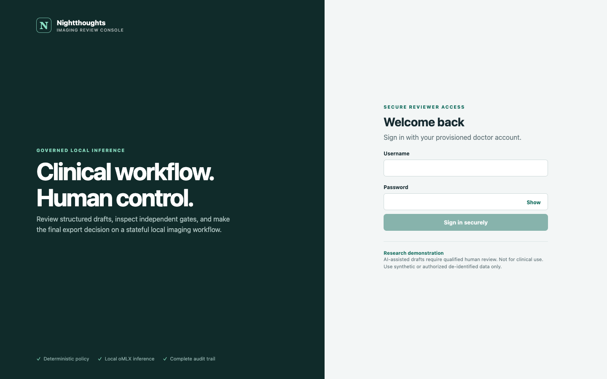

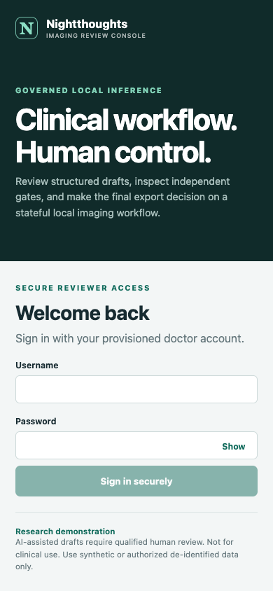

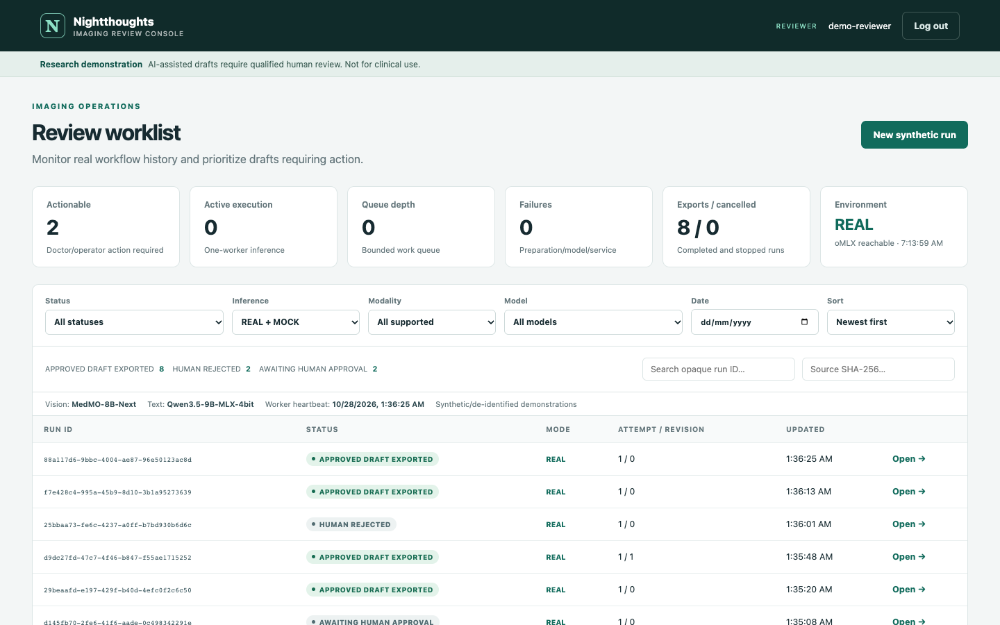

Incorrect credentials return the generic **Invalid username or password** message; no account existence detail is exposed. The current limiter blocks a username/IP key for 30 seconds after each group of five failed attempts and returns **Too many attempts; try again later**.

Sessions have an **8-hour absolute lifetime** and a **30-minute idle timeout**. Activity extends the idle window but not the absolute limit. Session cookies are opaque random values stored only as hashes server-side. Production cookies are Secure, HttpOnly where appropriate, SameSite=Strict, and `__Host-` prefixed. State-changing requests also require CSRF validation.

**Log out** deletes the server session. Password reset invalidates every session. There is no self-service password-change page after login; use the protected local reset command. If the original password is unknown, do not attempt hash recovery: reset it locally.


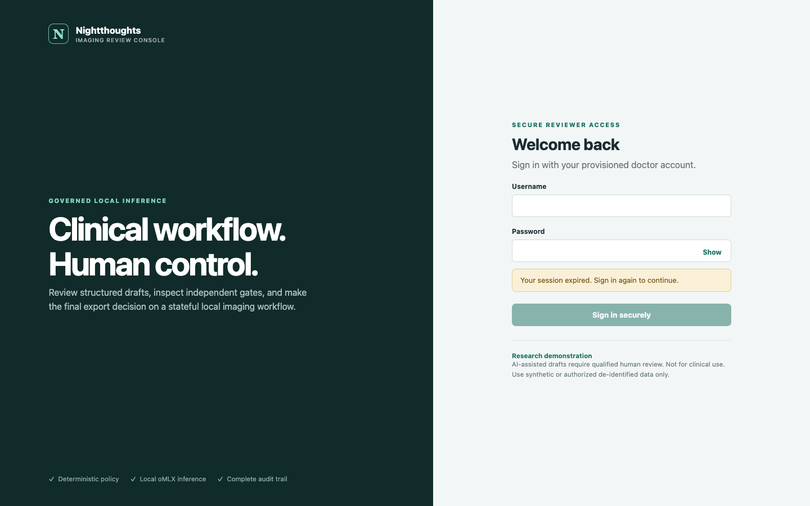

On phones, **Menu** opens a focus-trapped navigation drawer with identity, worklist, and logout. Escape/Close returns focus to the menu button.

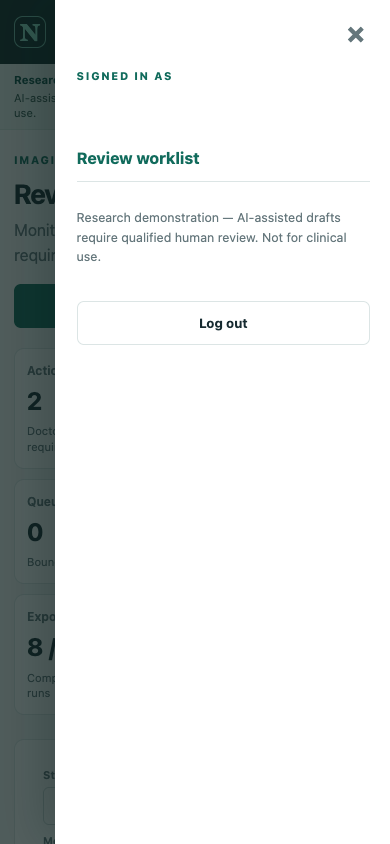

## 4. Supported inputs

- One synthetic or authorized de-identified artifact per run.
- PNG, JPEG, or constrained single-frame CR/DX DICOM.
- DICOM modality `CR` or `DX`, supported SOP class, one frame, and uncompressed little-endian transfer syntax.
- PNG/JPEG requires the user declaration `XR`; it is not a classifier result.
- Default upload limit is 26,214,400 bytes and decoded-pixel limit is 25,000,000.

CT, MRI, ultrasound, nuclear medicine, multi-frame/cine/3D data, encapsulated PDF, structured reports, unsupported compression, nested sequences other than one supported VOI LUT sequence, unreadable pixels, and unresolved PHI concerns are not supported. Whole-study CT/MRI needs a different pipeline.

PHI screening re-encodes raster working copies and runs local OCR. DICOM screening checks identifying/descriptive/temporal fields, private tags, overlays, and sequences, replaces internal UIDs, and re-reads derived files. The Imaging Readiness Agent re-screens prepared pixels before drafting. This is fail-closed screening, not guaranteed anonymization or DICOM PS3.15 conformance. Use no real patient identifiers.

## 5. Complete happy path

### Confirm the environment

1. Check `/health/ready` and oMLX `/health`.
2. Confirm the worklist environment badge says **REAL**.
3. Confirm queue health and one active worker. Another active run enters the bounded queue; it does not create concurrent inference.

### Upload

1. Choose **New synthetic run**.
2. Select a synthetic or authorized de-identified patient image.
3. For PNG/JPEG, leave modality declaration as **XR — chest radiograph**. DICOM modality comes from validated metadata.
4. Confirm **I confirm this is synthetic or authorized de-identified data.**
5. Choose **Create run**.

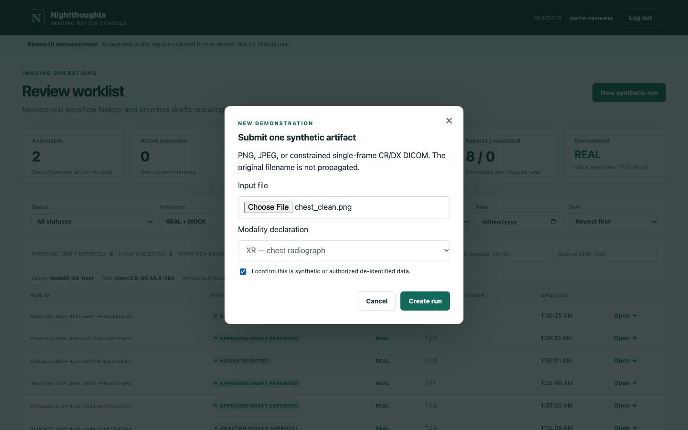

The application stores an opaque artifact ID, not the original filename in prompts, reports, or logs. The run ID and thread ID are identical random UUIDs; the artifact ID is independent.

### Monitor the graph

Open the run. The monitor shows current status, attempt, revision, model calls, timestamps, and independent gates.

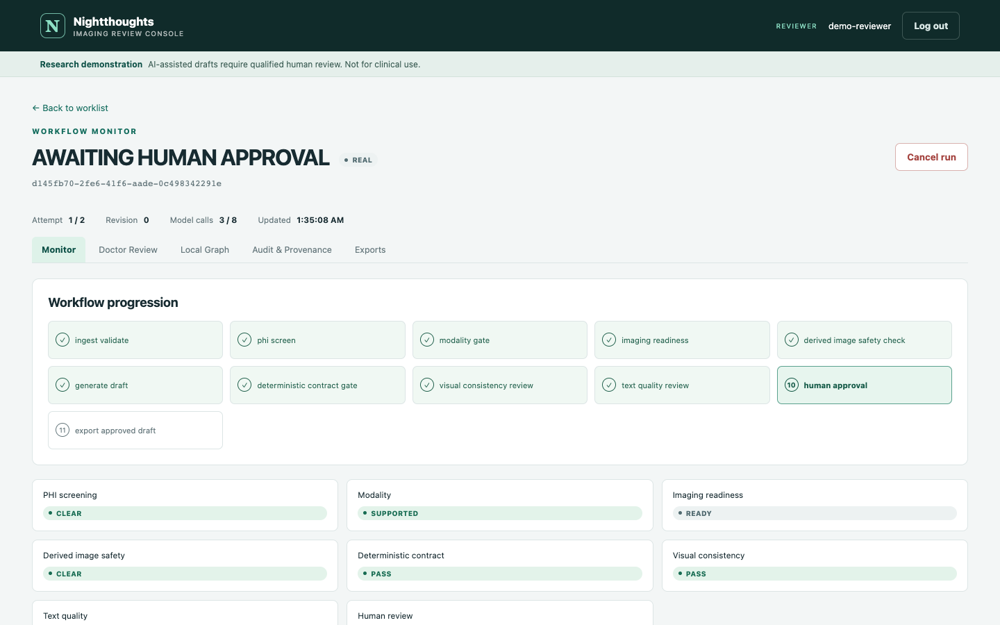


The stages are:

1. **Ingest validation:** regular-file/type/size/pixel checks and full SHA-256.
2. **PHI screening:** derived copy and OCR/metadata policy. It does not prove anonymization.
3. **Modality gate:** supported format, metadata, and declaration. It does not establish diagnostic suitability.
4. **Imaging Readiness Agent:** deterministic Modality LUT/rescale, calibrated VOI/window, signed and MONOCHROME1/2 semantics, decoded orientation, bounded aspect-preserving resampling, lossless PNG, hashes, metrics, and preparation receipt. It does not make findings or prove diagnostic preservation.
5. **Derived-image safety check:** verifies and re-screens prepared pixels. Failure stops before inference.
6. **Draft generation:** fixed prompt and strict structured schema, not a diagnosis.
7. **Deterministic contract gate:** required sections, lengths, placeholders, duplicates, contradictions, and notice—not clinical truth.
8. **Visual-consistency review:** model-assisted comparison with the derived image—not independent verification.
9. **Text-quality review:** model-assisted clarity, consistency, uncertainty, and limitations—not export authorization.
10. **Human approval:** a typed `interrupt()` awaiting the doctor.

A new draft resets visual and quality statuses. A failed visual review never gets erased by a later quality pass. Retry exhaustion goes to human review, never export. `IMAGE_PREPARATION_FAILED` means no model call and no export.

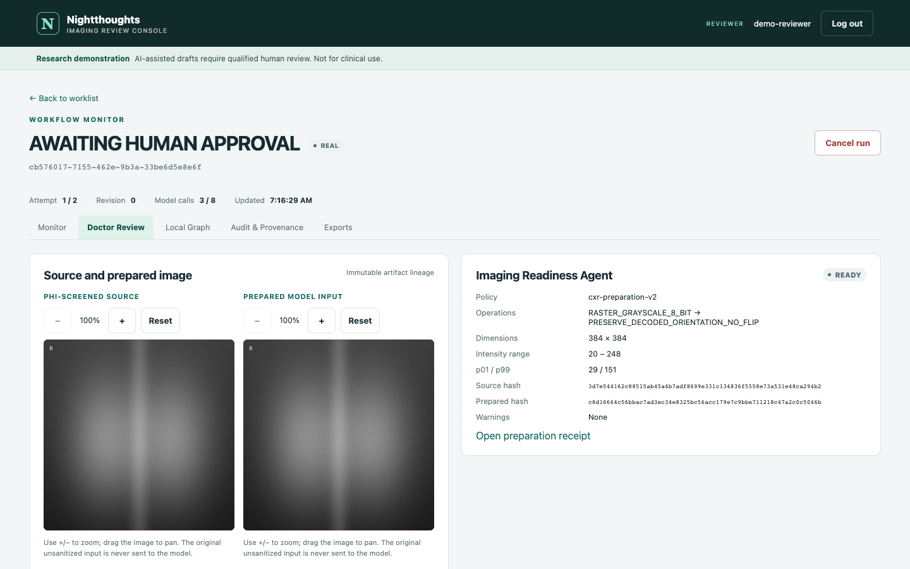

### Review and decide

Open **Doctor Review**. Compare the PHI-screened source and prepared model input, inspect readiness operations/dimensions/intensity/warnings/hashes, and open the preparation receipt. Then inspect findings, impression, limitations, independent review issues, decision history, model/prompt/policy/workflow versions, and revision number.


Choose exactly one action:

- **Approve export:** opens a confirmation explaining the consequence.
- **Reject draft:** requires a note and terminates without export.
- **Request changes:** requires feedback and creates a bounded revision, resetting downstream statuses.

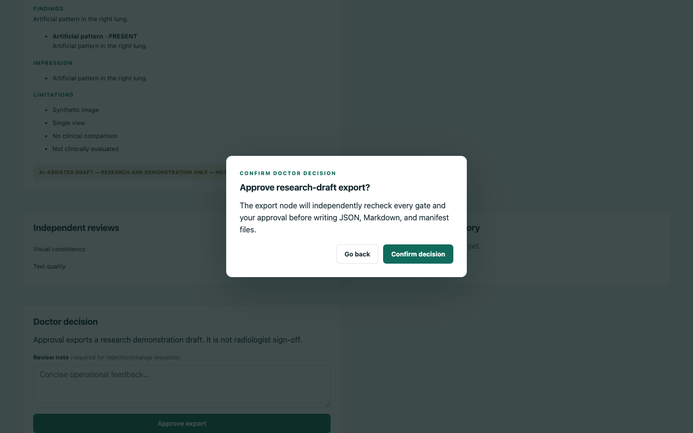

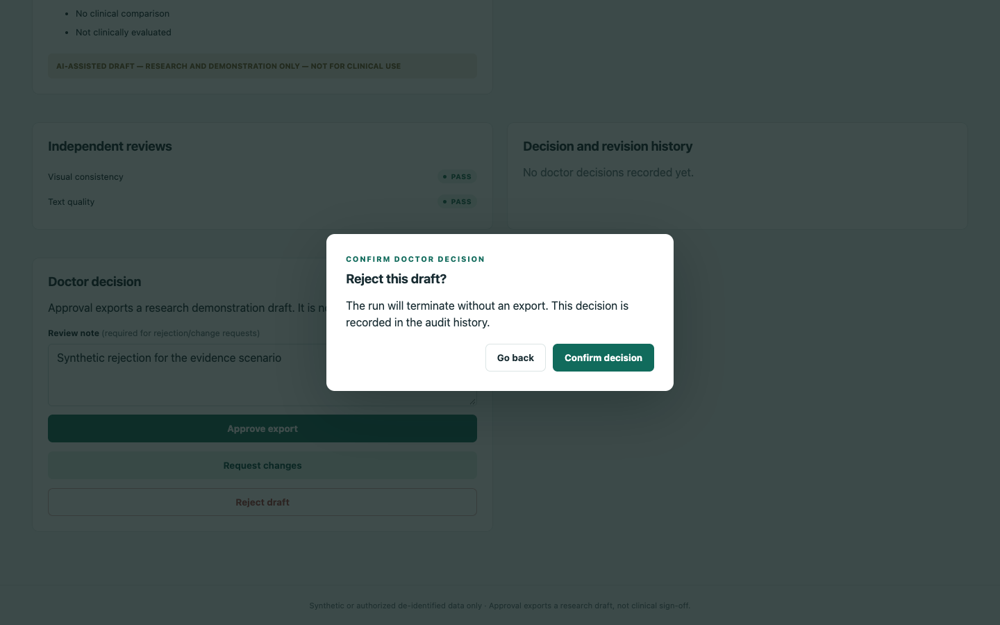

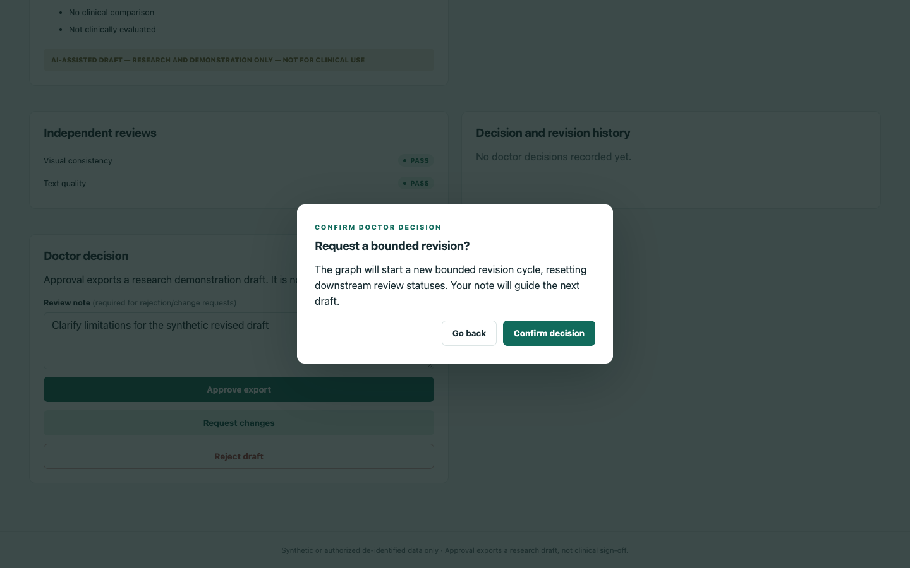

Approval is not clinical sign-off. The export node independently rechecks PHI, modality, readiness, derived-image safety, all draft gates, attempts, schema, cancellation, and typed approval before writing anything.

### Revised draft

After Request Changes, wait for the next draft and all gates to pass again. Compare revision history and feedback before deciding.


### Export and provenance

Eligible approved runs provide:

- `report_<run_id>.json`
- `report_<run_id>.md`
- `manifest_<run_id>.json`

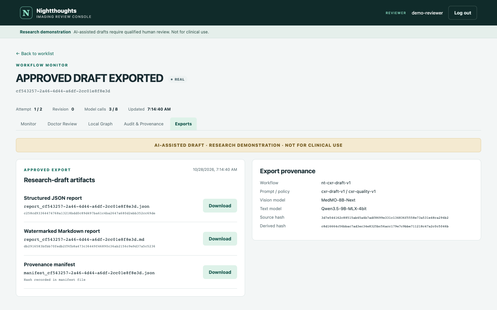

Downloads use the run-scoped authenticated endpoints. Verify the SHA-256 values in the manifest and inspect workflow/model/prompt/policy versions and source/derived hashes.

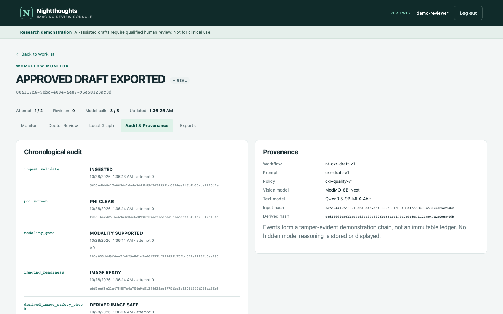

Use **Local graph** to inspect current/completed/pending nodes, checkpoint thread, failed edge, timings, preparation metadata, and actual model-call receipts. No hosted tracing account is required.

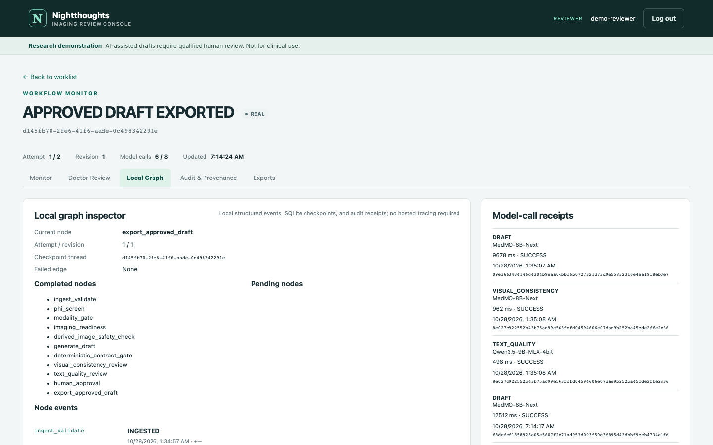


## 6. Mobile doctor workflow

The phone UI uses mobile run cards, a compact navigation drawer, vertical workflow steps, a Source/Prepared switcher, stacked image/draft/review panels, full-screen dialogs, and a safe-area-aware decision area. The tested viewport is emulated real Chromium, not a physical phone.

1. Log in at the phone-sized viewport.
2. Open **Menu** for worklist/logout.
3. Use filters or **Search opaque run ID** to find a run. Failed and awaiting-review states remain visible.
4. Open the run card and inspect status, attempt, revision, and timestamps.
5. Use **Doctor Review** to switch between source and prepared images, then read the structured report and readiness details.

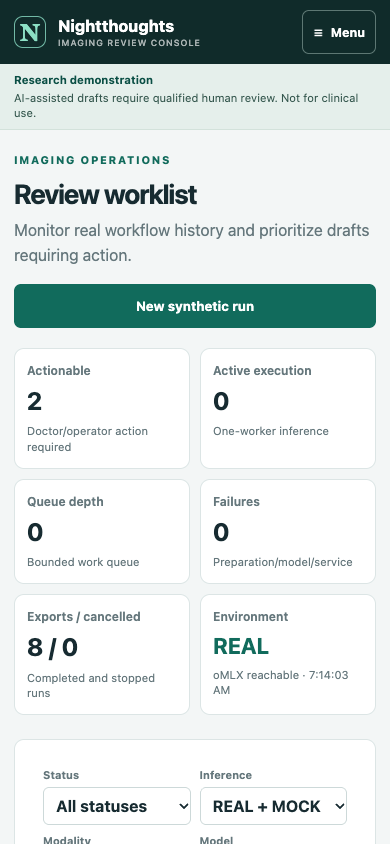

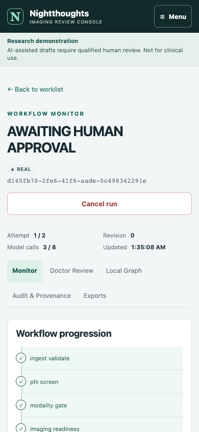

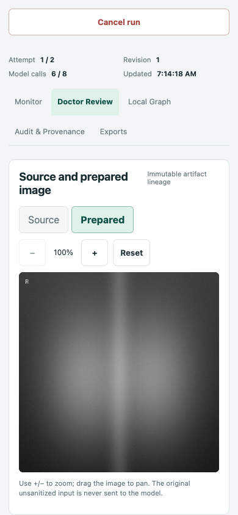

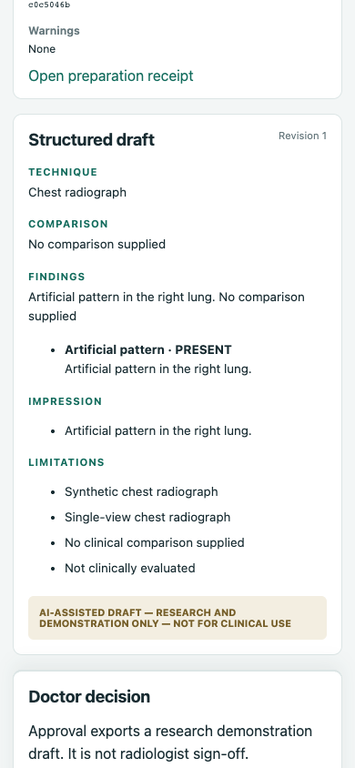

Use **+ / −** for image zoom and drag to pan inside the bounded image viewport. **Reset** restores fit. Zoom/pan does not create page-level horizontal scrolling.


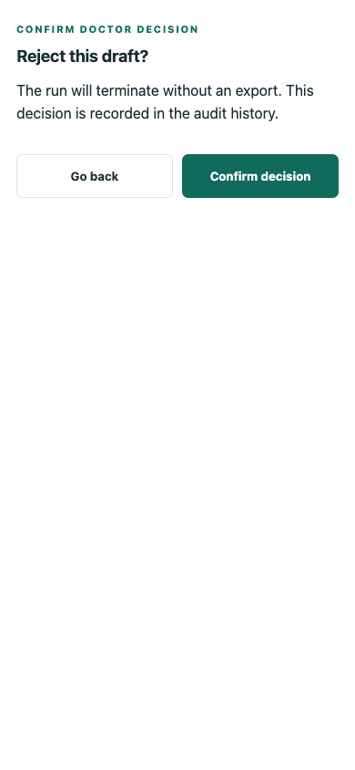

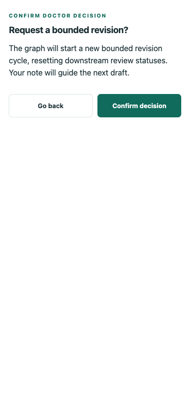

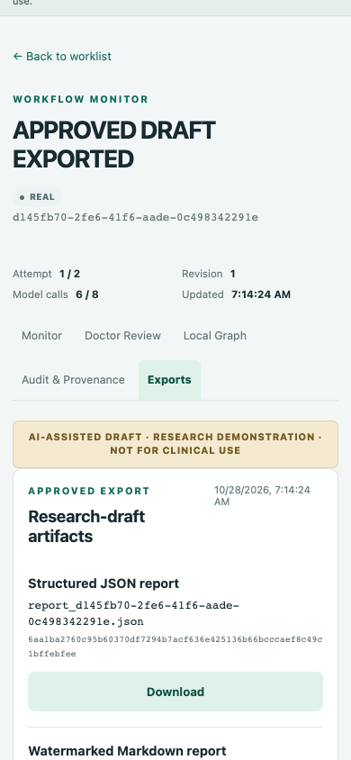

Notes are entered with the native mobile keyboard. The focused field and buttons remain reachable. Consequential actions require confirmation and busy controls prevent double submission. Offline polling can show an error; after reconnecting, the same run/thread resumes. Session expiry returns to login without deleting the run.

## 7. Decision and export table

| Decision/outcome | Graph result | Export allowed? |
|---|---|---|
| All gates pass + APPROVE | `APPROVED_DRAFT_EXPORTED` | Yes, once, idempotently |
| REJECT with note | `HUMAN_REJECTED` | No |
| REQUEST_CHANGES with note | New bounded revision and another interrupt | Not until revised gates pass and approval |
| Revision limit exhausted | `NEEDS_HUMAN_REVIEW` | No |
| Retry exhausted | `NEEDS_HUMAN_REVIEW` | No |
| PHI concern | `QUARANTINED` | No |
| Unsupported/ambiguous modality | `NEEDS_HUMAN_REVIEW` or quarantine | No |
| Persistent malformed model output | `MODEL_OUTPUT_INVALID` | No |
| Model/provider technical failure | `FAILED` | No; only explicit technical retry if eligible |
| Cancellation accepted | `CANCELLED` | No |
| Worker interrupted mid-call | Recovery review/failed state | No automatic replay/export |
| Existing approved replay | Same completed export | No duplicate files/events |

## 8. All supported scenarios and recovery actions

The following describes actual behavior. Fault profiles are test-only and cannot be enabled in REAL mode. Run the isolated consoles and authenticated showcase runners locally:

```bash
./scripts/mock_guide.sh
./scripts/real_showcase.sh
uv run python scripts/run_showcase.py --mode MOCK --base-url http://127.0.0.1:8002 --data-root var/guide-mock --output evidence/showcase/mock-runs.json
uv run python scripts/run_showcase.py --mode REAL --base-url http://127.0.0.1:8003 --data-root var/real-showcase --output evidence/showcase/real-runs.json
```

Open MOCK at `http://127.0.0.1:8002` and the separate REAL showcase at `http://127.0.0.1:8003`. The deployed public service remains REAL. The runner creates genuine graph runs and decisions through the API; it never seeds completed outcomes in SQL.

| # | Scenario and safe trigger | What you see / next action | Export |
|---|---|---|---|
| 1 | All gates pass; approve | Confirmation, then JSON/Markdown/manifest | Allowed once |
| 2 | Reject with note | `HUMAN_REJECTED`; audit records reason | Never |
| 3 | Request Changes with feedback | Bounded revision, new draft and gates | Only after new approval |
| 4 | Review revised draft | Revision increments; compare and decide | Only after new approval |
| 5 | Revision limit reached | `NEEDS_HUMAN_REVIEW`; no force-approve | Never |
| 6 | Cancel queued run | `CANCELLED`; queued work does not start inference | Never |
| 7 | Cancel active run | Cooperative cancellation after the current call; a completed export cannot be cancelled | Never after acceptance |
| 8 | Cancel awaiting review | Later approval cannot export, including a late worker response | Never |
| 9 | Retry retryable technical failure | **Retry technical failure** creates a new run; failed gates are not bypassed | Only if new run passes |
| 10 | PHI metadata/private tag concern | `QUARANTINED` with reason codes | Never |
| 11 | Burned-in unexpected text | OCR blocks before inference; zero model calls | Never |
| 12 | OCR engine failure | Fail-closed quarantine; investigate OCR availability | Never |
| 13 | CT/MR/US modality metadata | `NEEDS_HUMAN_REVIEW`; no drafting | Never |
| 14 | Multi-frame/unsupported DICOM | Rejected before inference, commonly quarantine due unsupported rendering | Never |
| 15 | Missing/ambiguous raster declaration | `NEEDS_HUMAN_REVIEW`; supply XR explicitly next run | Never |
| 16 | Malformed/truncated upload | Ingest rejects with safe error | Never |
| 17 | Byte/pixel limit exceeded | HTTP 413 or ingest `NEEDS_HUMAN_REVIEW`; reduce file | Never |
| 18 | One malformed model response | At most one syntax repair in same attempt and budget | Only if all gates pass |
| 19 | Persistent malformed output | `MODEL_OUTPUT_INVALID` | Never |
| 20 | `grounding_fail_once` | First visual review fails, next draft passes | Only after approval |
| 21 | `grounding_fail_always` | Bounded attempts end `NEEDS_HUMAN_REVIEW` | Never |
| 22 | `quality_fail_once` | Quality fails once, next draft passes | Only after approval |
| 23 | `quality_fail_always` | Bounded attempts end `NEEDS_HUMAN_REVIEW` | Never |
| 24 | `model_timeout` | `FAILED`, bounded timeout, no mock fallback | Never |
| 25 | `model_unavailable` | `FAILED`; check oMLX/auth/model IDs | Never |
| 26 | Queue full/another inference active | One at a time; 8 active+queued jobs fill the bound, then HTTP 429 | Existing runs unaffected |
| 27 | Session expires awaiting review | Login again; thread/draft remain | Continue after reauthentication |
| 28 | API/worker restart | Recovery review/failed state; explicit technical retry if eligible | No automatic duplicate export |
| 29 | Resume/replay approved run | Same hashes/files, one idempotency record | No duplicates |
| 30 | Approval attempted with failed gate | API/export rejects; no override | Never |
| 31 | Cross-run artifact/export request | Run-scoped validation returns 404/denies access | Never |
| 32 | REAL versus MOCK | REAL uses oMLX; MOCK visibly labels synthetic test evidence | Separate explicit modes |
| 33 | Approve/reject on phone | Same typed decision, confirmations, and gates as desktop | Same rules |
| 34 | Mobile offline interruption | Polling can error; reconnect and refresh same thread | Preserved if already exported; otherwise continue |
| 35 | Uniform/invalid preparation input or `derived_phi_block` | `IMAGE_PREPARATION_FAILED`; no model call or approval override | Never |
| 36 | `model_timeout` recovery | Retry only when the error is retryable; new run must pass every gate | Only after new approval |

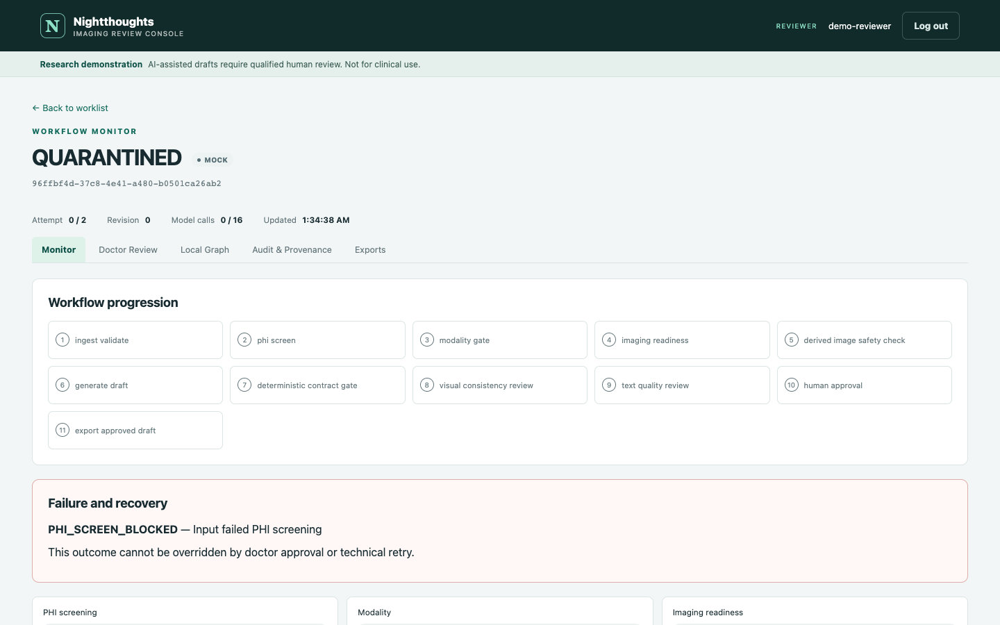

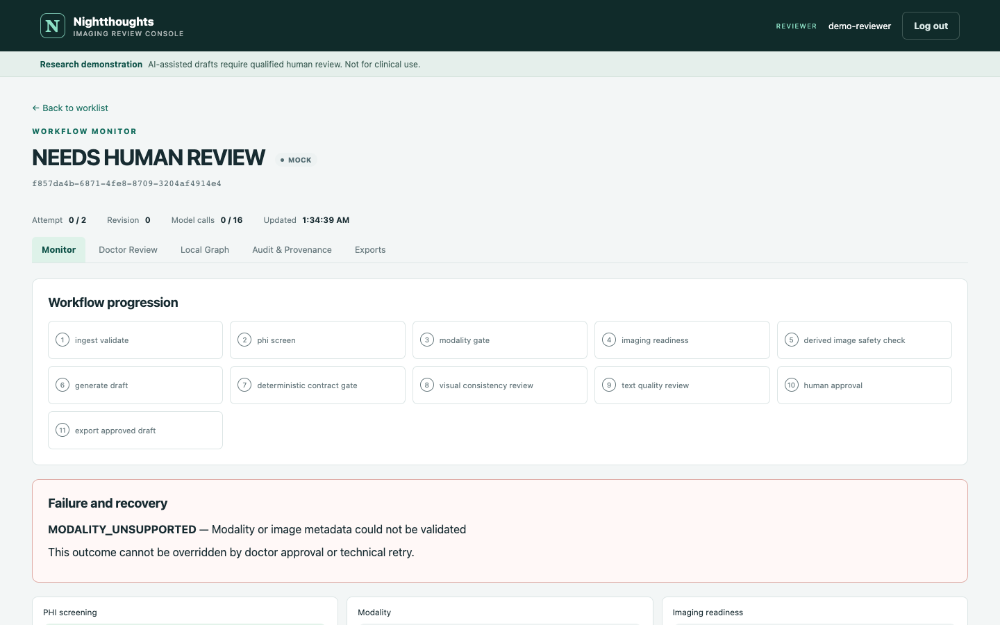

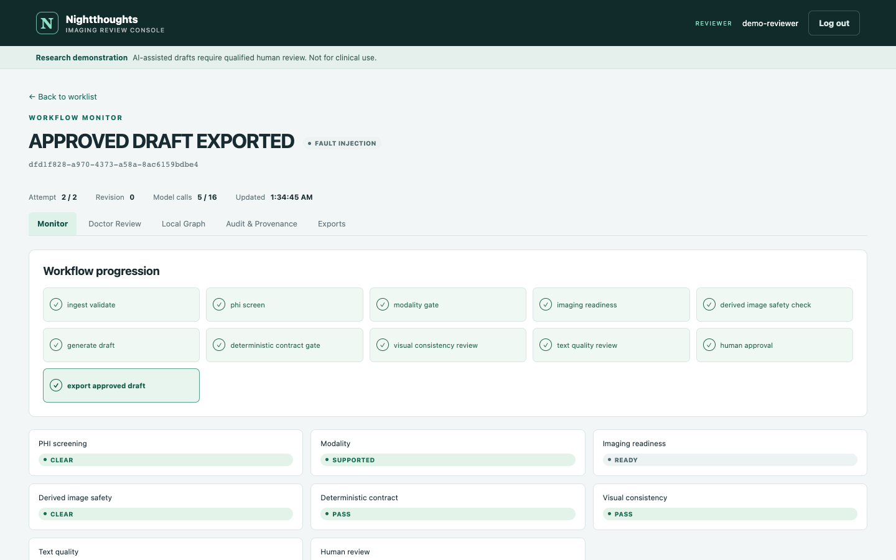

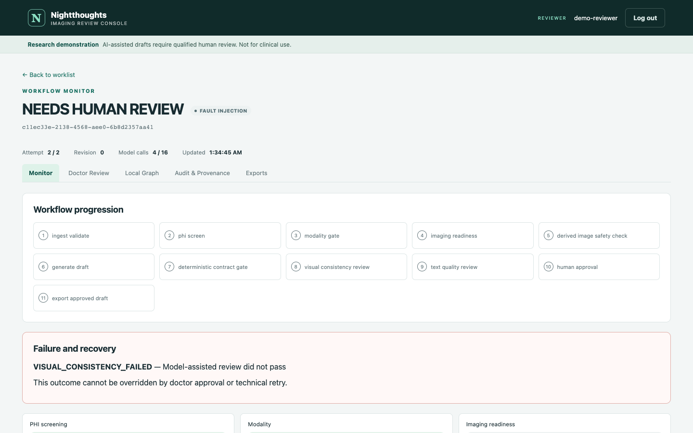

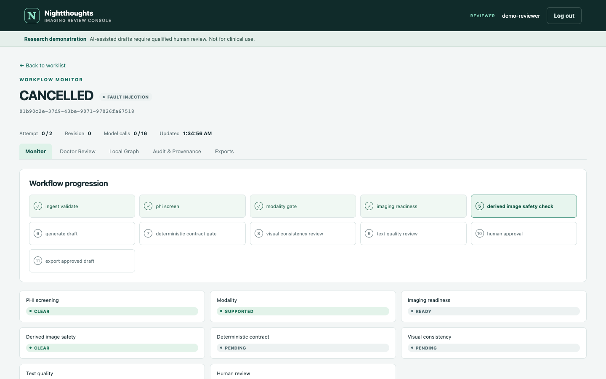

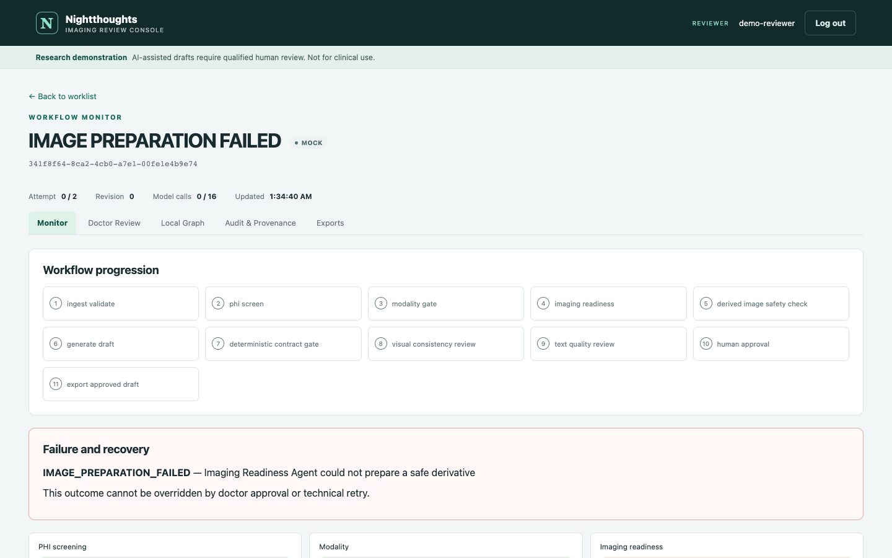

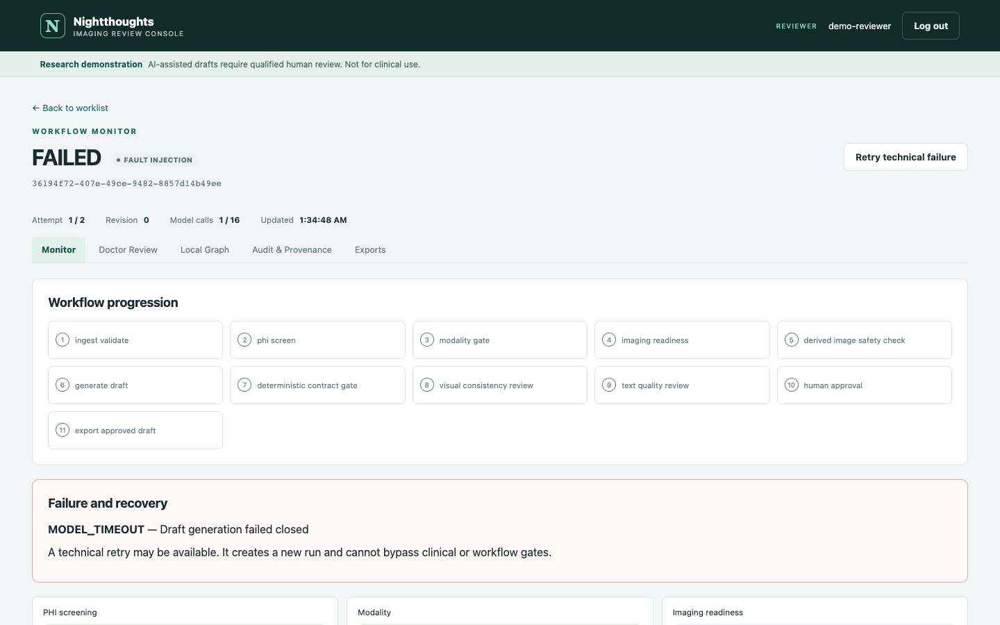

**MOCK images are workflow fault-injection evidence only, not model-quality or clinical evidence.**

## 9. Troubleshooting

### Invalid credentials or login fails

Verify the exact provisioned username and password. Use `<your-doctor-password>`, not an old reset. Check rate limiting and retry after the displayed cooldown. If unknown, use `./scripts/create_doctor.sh --reset`; do not attempt hash recovery.

### Expired session

Log in again. The run and draft remain checkpointed. Logout does not delete runs.

### Local portal unavailable

```bash
launchctl print system/com.nightthoughts.imaging.api
launchctl print system/com.nightthoughts.imaging.worker
curl http://127.0.0.1:8001/health/live
tail -n 100 var/logs/api-service-error.log
tail -n 100 var/logs/worker-service-error.log
```

Check port 8001 ownership; do not kill unknown processes.

### Public hostname fails while local works

```bash
caddy validate --config /opt/homebrew/etc/Caddyfile
cloudflared tunnel ingress validate
curl -H 'Host: imaging.nightthoughts.dev:9080' http://127.0.0.1:9080/
```

Check the imaging Caddy block, ingress rule, DNS CNAME, and existing tunnel process. Do not add a duplicate tunnel or expose internal ports.

### Worker not processing

Check `/health/ready`, `launchctl print system/com.nightthoughts.imaging.worker`, and worker logs. Inspect queued/running jobs and memory pressure. Only one inference runs at a time. A full queue returns 429; wait rather than bypassing the limit.

### oMLX unavailable or unauthorized

```bash
curl http://127.0.0.1:8000/health
./scripts/doctor.sh
./scripts/configure_models.sh
```

Use exact IDs from authenticated `/v1/models`. The provider reads the existing inference key in memory; never print or copy it. Do not restart oMLX unless separately approved.

### Model not registered or memory pressure

Run `./scripts/configure_models.sh` and select an existing exact ID. Do not invent model names or download duplicates. Close a run and wait for queued work; do not stop other applications to free memory without approval.

### Upload rejected

Check content magic, regular-file status, size, decoded pixels, DICOM transfer syntax/frame count/SOP class/modality, and authorization confirmation. Original filenames are not accepted as a modality engine.

### PHI quarantine

Use synthetic fixtures only. Inspect reason codes, not raw removed values. OCR failure also blocks. Do not bypass with direct model calls.

### Run awaiting review

Open **Doctor Review**. No export exists yet. Approve, reject with a note, or request changes with a note.

### Export unavailable

Check all gates, approval, cancellation, revision/attempt limits, and run status. Only `APPROVED_DRAFT_EXPORTED` exposes downloads. Failed-gate approvals and cross-run paths are denied.

### Mobile layout or connection issues

Use a current browser and confirm viewport zoom is 100%. The phone UI supports mobile cards, vertical steps, bounded zoom/pan, and full-screen dialogs. Offline polling may fail; reconnect and refresh. No physical-device testing is implied by Chromium viewport emulation.

### Service recovery after restart

Recovery does not automatically replay in-flight inference. Inspect `WORKER_RESTART_RECOVERY`, then explicitly retry only if eligible. Existing approved exports remain idempotent; audit counts must not increase on replay.

## 10. Operator evidence

```bash
make test-browser
uv run python scripts/build_v3_evidence.py
```

The authoritative manifest is `evidence/manifest-v3.json`. It records test totals, model/service versions, deployment status, run/thread/model-call correlation, screenshot/export hashes, fixture provenance, and limitations. Do not include credentials, cookies, tokens, password hashes, private account details, or real patient information in evidence. For Hashnode, images are uploaded through the CLI and referenced only by the returned CDN URLs; local paths are never used.
