# Beyond Vibe Coding: Building and Maintaining an Expense Tracker with GitHub Spec Kit

_A practical walkthrough of specifications, clarification, quality gates, implementation, convergence, and structured bug fixing._

I built an expense tracker to discover where my money was going. The results were shocking: apparently, ‘just one more coffee’ is not a valid financial strategy. ☕

The technical premise is simple: a coding agent works better when it has to make decisions explicit and verify them. A prompt can produce an interface. It does not define monetary rules, failure behavior, accessibility, or acceptance evidence.

This experiment used GitHub Spec Kit 1.2.5 to build a real React expense tracker, test it in Chromium, find and fix a genuine crash, and leave a reproducible trail. The main implementation used the supported Kimi Code 2.3.0 integration. A separate read-only demonstration used GitHub Copilot Chat; it did not generate the application.

The result is functional, but not every verification claim is complete. VoiceOver review was not performed, so full convergence remains open. That distinction is part of the experiment.

## 1. Why “build me an expense tracker” is underspecified

A vague feature request leaves important questions unanswered:

- Are amounts floating-point dollars or exact minor units?
- Does a month end in UTC or local time?
- Can an expense be future-dated?
- Does filtering change the monthly total?
- What happens when browser storage contains invalid JSON?
- Is deletion reversible?
- Can keyboard users escape every dialog?

These decisions change both implementation and tests. If the agent guesses silently, later code reviews must reconstruct product intent from implementation details.

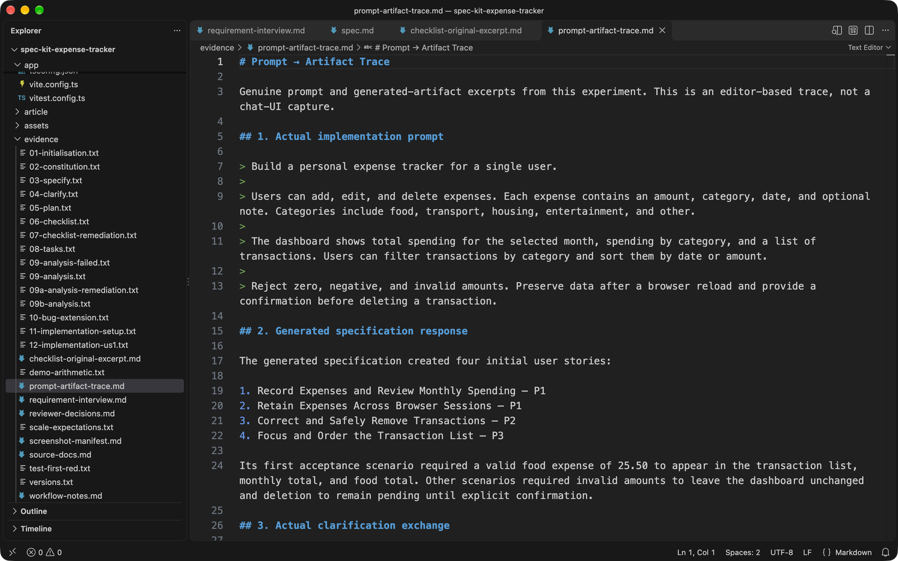

Spec Kit moves those decisions into inspectable artifacts. A specification records behavior. A plan records technical choices. Tasks sequence the work. Implementation changes code. Verification checks the result against the earlier intent.

## 2. What we will build

The application is a frontend-only personal expense tracker with:

- add, edit, and confirmed deletion;
- amount, category, local date, and optional note;
- food, transport, housing, entertainment, and other categories;
- monthly navigation and exact monthly/category totals;
- category filtering and date or amount sorting;
- useful empty states and visible validation;
- localStorage persistence and guarded malformed-data recovery;
- keyboard-accessible forms and native dialogs;
- desktop and mobile layouts;
- an isolated, deterministic fictional demo dataset.

Amounts are integer cents. Dates remain `YYYY-MM-DD` strings, so October 31 does not become November 1 through a UTC conversion.

The demo is activated only by `?demo=1`. It uses fixed in-memory records and never reads, writes, or listens to real storage. October 2026 contains eight expenses totaling **$1,732.65**. Two additional records exercise adjacent months.

## 3. Prerequisites and exact versions

The following versions were used, not inferred from a generic setup guide:

| Tool                            | Version                         |
| ------------------------------- | ------------------------------- |
| Spec Kit CLI                    | 1.2.5                           |
| Main coding-agent integration   | Kimi Code 2.3.0                 |
| Node.js / npm                   | 22.23.3 / 10.9.9                |
| uv / Spec Kit Python runtime    | 0.13.0 / 3.12.15                |
| React / ReactDOM                | 19.3.1                          |
| TypeScript                      | 5.9.3                           |
| Vite / React plugin             | 8.3.5 / 6.1.2                   |
| Vitest / jsdom                  | 4.1.12 / 29.1.1                 |
| Playwright                      | 1.64.1                          |
| Reference Chromium              | Chrome for Testing 156.0.8078.4 |
| axe-core Playwright integration | 4.14.0                          |
| VS Code                         | 1.143.1                         |
| Hashnode CLI                    | 0.1.1                           |

Node.js 20.19 or newer is the declared minimum. The application needs no backend, database, environment variables, or remote service.

Install Spec Kit and Playwright’s Chromium before reproducing the workflow:

```bash
uv tool install specify-cli
cd experiments/spec-kit-expense-tracker/app
npm ci
npx playwright install chromium
```

## 4. Initialising Spec Kit

The application workspace was initialized directly with the current CLI:

```bash
specify init experiments/spec-kit-expense-tracker/app \
  --integration kimi \
  --script sh \
  --non-interactive
```

This installed the constitution scaffold, templates, scripts, workflows, and coding-agent skills. Spec Kit’s official documentation was also used to select the integration and confirm the bug-extension syntax.

The first agent invocation failed because this CLI did not allow `--auto` with `--prompt`. That failure changed no files. Prompt mode without `--auto` worked. This is why recorded commands matter: remembered flags are not authoritative.

## 5. Establishing engineering rules with a constitution

The first workflow stage established six non-negotiable rules:

1. Persist and calculate money as integer minor units.
2. Target WCAG 2.2 AA-oriented accessibility.
3. Test business rules and important UI interactions.
4. Separate UI, calculations, and persistence.
5. Confirm destructive actions.
6. Make persistence failures visible and avoid silent data loss.

```text
/speckit-constitution Establish exact monetary arithmetic,
accessibility, behavioral tests, separated modules, destructive
confirmation, and non-destructive persistence recovery.
```

The constitution is more than decoration. Later convergence checks the implementation against these rules. For example, storage code cannot quietly replace malformed data with an empty collection, because that would destroy recoverable information.

## 6. Writing the specification

The baseline prompt became a structured specification with user stories, acceptance scenarios, functional requirements, entities, and measurable outcomes.

```text
/speckit-specify Build a personal expense tracker for a single user.
Users can add, edit, and delete expenses. Each expense contains an
amount, category, date, and optional note. Reject zero, negative, and
invalid amounts. Preserve data after reload and confirm deletion.
```

The generated specification made category filtering list-only: monthly totals still represent every expense in the selected month. It also treated missing storage as a normal empty state, not an error.

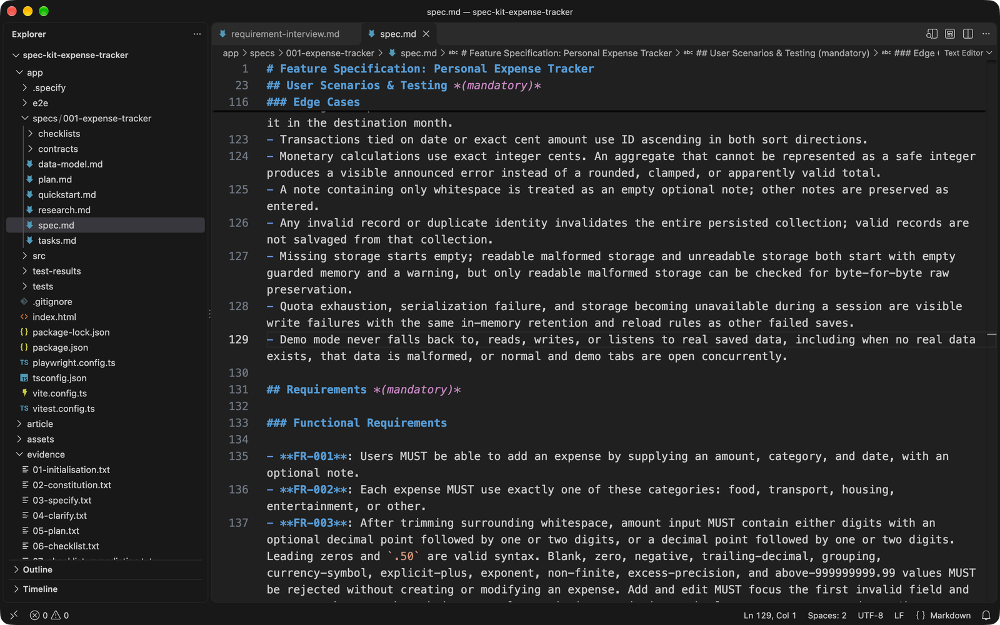

This is the distinction between a specification and a plan. The specification says **what** the user must be able to do and which outcomes are acceptable. It does not choose React, Vite, or a storage schema.

## 7. Clarifying what the agent should not guess

Clarification resolved seven decisions explicitly:

- USD with fixed `en-US` formatting and two decimals;
- local whole-day calendar months with inclusive boundaries;
- future expenses allowed only in their own month;
- permanent deletion with no undo and initial focus on Cancel;
- malformed data preserved until confirmed replacement;
- distinct empty-month and empty-filter actions;
- deterministic fictional data isolated from real persistence.

```text
/speckit-clarify Resolve currency, month boundaries, future dates,
deletion, malformed storage, empty states, and demo isolation.
```

These answers became acceptance scenarios and requirements, not notes lost in a chat. For example, FR-022 requires no write before informed replacement confirmation. FR-029 prohibits demo storage reads, writes, and listeners.

## 8. Producing the technical plan

Only after clarification did the plan choose React, TypeScript, and Vite.

```text
/speckit-plan Use React, TypeScript, and Vite. Keep money as integer
cents and dates as local strings. Separate domain, persistence, and UI.
Use Vitest, React Testing Library, and Playwright Chromium.
```

The plan produced `research.md`, `data-model.md`, a UI contract, and a quickstart. It defined a version-1 storage envelope and all-or-nothing validation. One invalid record makes the collection unreadable as a whole; valid-looking siblings are not silently salvaged.

The source structure preserves those boundaries:

```text
domain/       pure validation, dates, money, and calculations
persistence/  sole real localStorage boundary
state/        React state and recovery transitions
components/   rendering and interaction
demo/         fixed fictional records
```

The initial plan included browser screenshots. That was later corrected to keep application captures independent from the coding agent. Playwright now uses fresh contexts and viewport-only images.

## 9. Checking requirement quality

The checklist stage found **37 requirements-quality findings**. They were not fabricated implementation bugs. They identified places where the documents were unclear or incomplete.

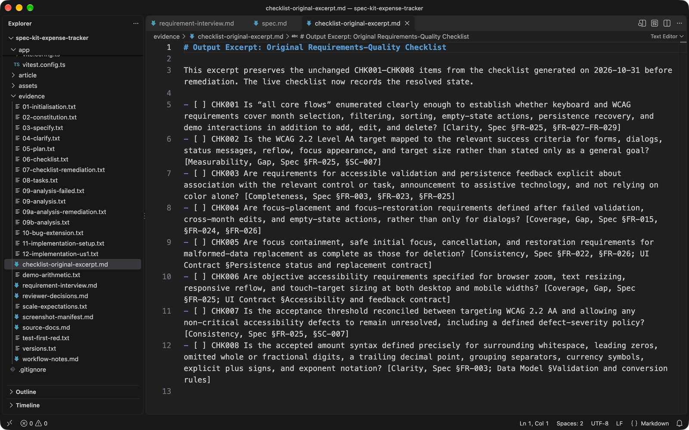

Useful examples included:

- amount syntax was not defined for `.50`, grouping, or exponent notation;
- aggregate overflow behavior was unspecified;
- failed-write reload semantics needed operation-specific rules;
- unchanged storage did not prove that demo mode avoided reads or listeners.

A reviewer remediation pass updated the specification, plan, data model, UI contract, and verification guide. Only then were the checklist items marked satisfied. Checkbox state represented requirements quality, not completed implementation.

## 10. Generating tasks and analysing consistency

The first task breakdown contained 73 tasks. For a small frontend demonstration, that was too granular. Related module and verification work was consolidated into **50 tasks** without dropping a requirement or named test case.

```text
/speckit-tasks Use a test-first strategy with an early runnable
missing-App failure before application source implementation.
/speckit-analyze
```

The first analysis process exited with code `-1` before producing a report. I preserved its log and did not treat it as a quality gate. A minimal official retry succeeded and found three medium issues and one low issue:

- nondeterministic focus after filtered edits and deletion;
- missing demo locale coverage;
- missing persistence round-trips for accepted amount cases;
- a stale test-file layout in the plan.

Those corrections were applied. The second analysis reported no findings and 100% nominal coverage across 38 buildable requirements.

## 11. Implementing the application

T001–T009 established the toolchain and a smoke test before `src/App.tsx` existed.

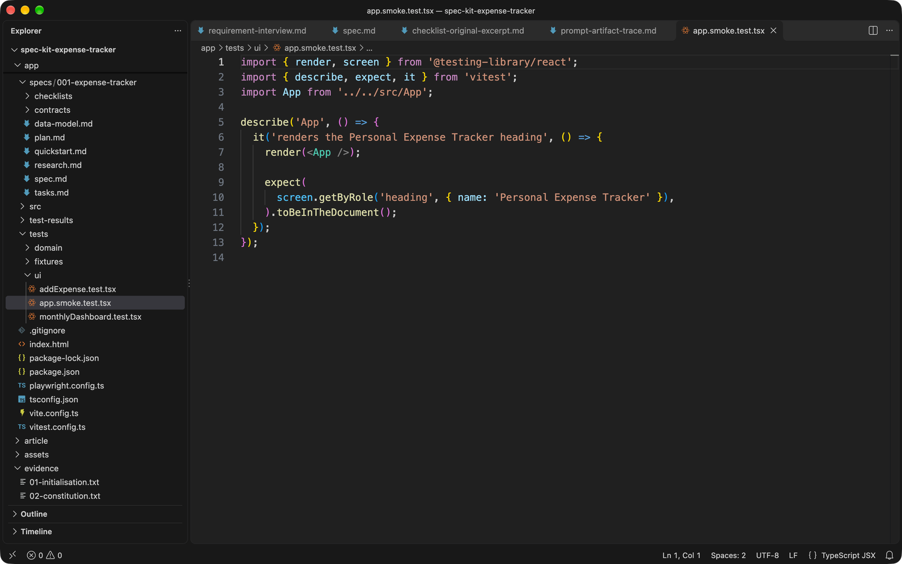

The first run failed for exactly that reason, not because Vitest was broken:

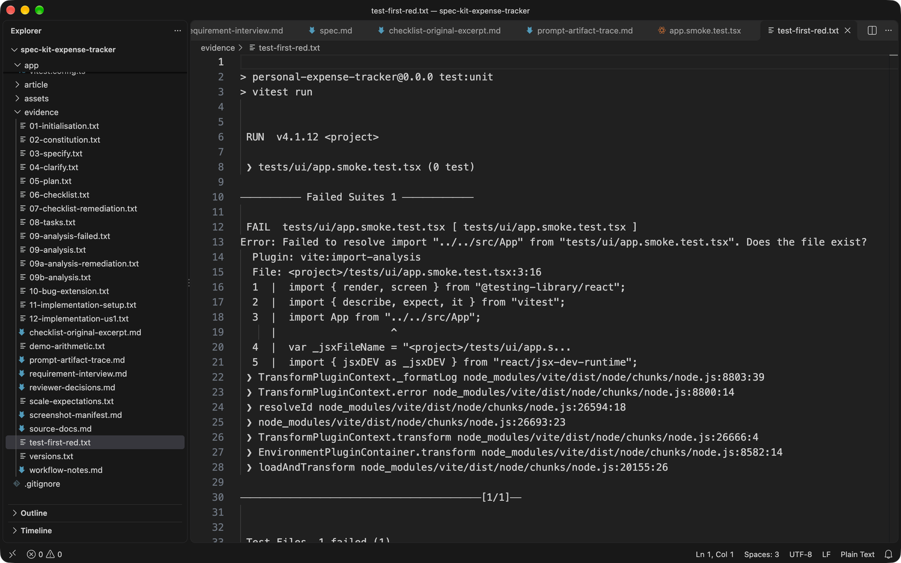

Subsequent stories followed the same pattern: tests first, meaningful red result, implementation, then regression checks. The final structure contains domain, persistence, React UI, and eight Playwright suites.

The money parser converts decimal strings directly into cents:

```ts
const [wholePart = "", fractionPart = ""] = normalized.split(".");
const amountCents = Number(`${wholePart || "0"}${fractionPart.padEnd(2, "0")}`);
```

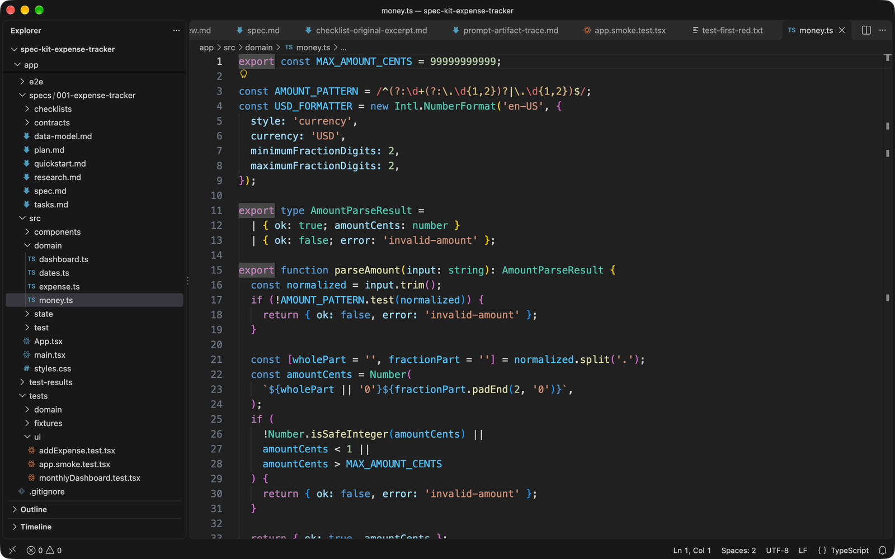

There is no binary floating-point input conversion or rounding step. Formatting happens only at the display boundary with a fixed USD formatter.

### Traceability in practice

FR-003 defines the accepted grammar as well as the rejected values. `1`, `001.2`, and `.50` are accepted. Blank input, zero, `-1`, `1.`, `1,000`, `$1`, `+1`, `1e2`, and more than two decimal places are rejected. The upper bound is explicit rather than left to unsafe integer arithmetic.

The same validator runs when adding and editing. Persisted records are checked against the same invariants. AMOUNT-001–008 exercise those cases, MONEY-004 confirms the stored values remain integer cents, and production checks confirm that `-1`, `abc`, `1.234`, and `0` produce visible errors without changing the total.

That is the useful chain: requirement → validator → observable error → regression test. A screenshot alone would prove none of it.

### Persistence is failure design

The storage contract distinguishes five situations: missing data, valid data, readable malformed data, unreadable storage, and failed writes. They are not interchangeable.

Missing data opens a normal empty dashboard. Readable malformed data starts an empty guarded collection while preserving the original raw value. Unreadable storage cannot be inspected, so the application makes no raw-preservation claim; it simply performs no write until confirmation.

An ordinary failed add, edit, or delete remains visible only in memory. Reload restores the last durable collection. A later successful mutation writes the complete current collection, including earlier retained work, and only then clears the warning.

These paths are tested by injecting storage failures before initialization and during mutations. Demo isolation uses separate instrumentation to assert zero reads, zero writes, and zero listener registrations. Checking an unchanged value would not establish those prohibitions.

### Accessibility beyond styling

The native deletion dialog starts with Cancel focused, contains Tab and Shift+Tab, closes safely on Escape, and restores focus to an appropriate surviving control. Similar rules apply to storage-replacement dialogs.

Automated checks cover labels, error associations, contrast, 24-pixel targets, 320-pixel reflow, 200% zoom, and 200% text resize. Production checks also exercised keyboard submission and native-dialog behavior. VoiceOver review remains a separate, uncompleted activity; automated accessibility results are not presented as screen-reader evidence.

## 12. Converging the code with the specification

Convergence found a genuine crash that the happy-path checks missed. Clearing the native Month control passed an empty string to `summarizeMonth`, which threw `Expected a valid local month` and unmounted the application.

T051 added a store-boundary guard:

```ts
const selectMonth = useCallback((month: MonthString) => {
  if (isMonth(month)) {
    setSelectedMonth(month);
  }
}, []);
```

The regression failed before the fix and passed afterward, including the real Chromium clear action.

A later full-browser run also exposed an intermittent edit-form race. The unchanged CORE-006 scenario failed 2 of 30 repetitions because a passive effect could restore the original draft after a fast amount edit. Moving draft initialization to `useLayoutEffect` fixed the demonstrated cause. The scenario then passed **100 of 100** desktop repetitions without changing its assertions.

Final convergence found no new gaps, but the feature is **not fully converged**. VoiceOver review and the dependent final gate remain open.

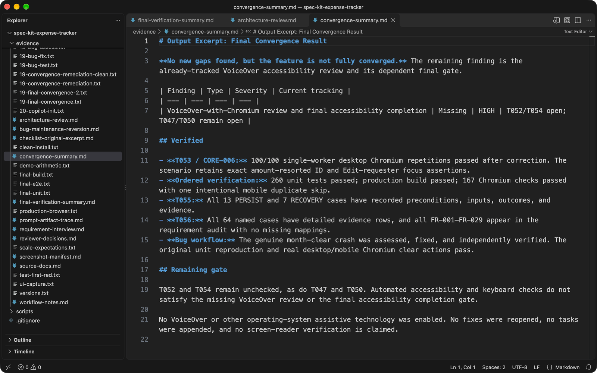

## 13. Running and inspecting the UI

The production application was served locally with Vite preview:

```bash
npm run build
npx vite preview --host 127.0.0.1 --port 4173
```

Every UI image was captured independently with `page.screenshot({ fullPage: false })` and a fresh Chromium context. Desktop captures are 1440×900; mobile is 390×844.

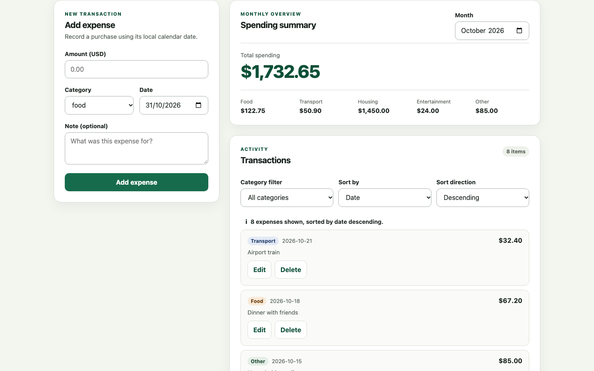

The October summary matches the independently calculated fixture: food **$122.75**, transport **$50.90**, housing **$1,450.00**, entertainment **$24.00**, and other **$85.00**.

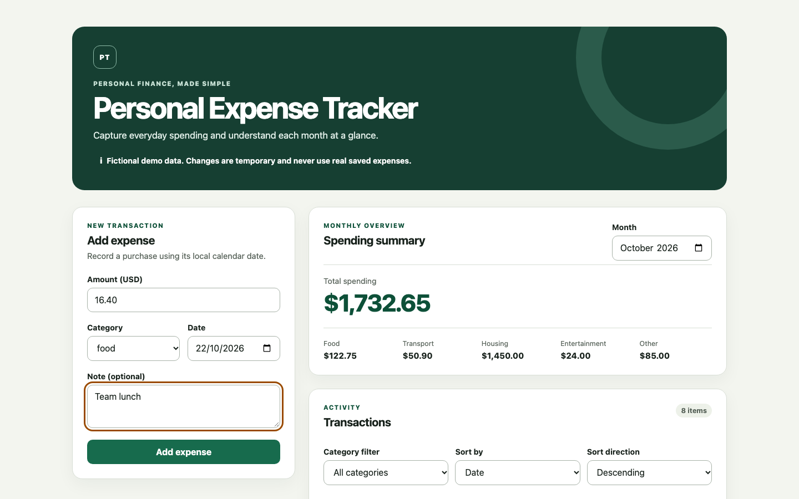

Filtering by food shows three transactions while the monthly total remains based on all eight October records.

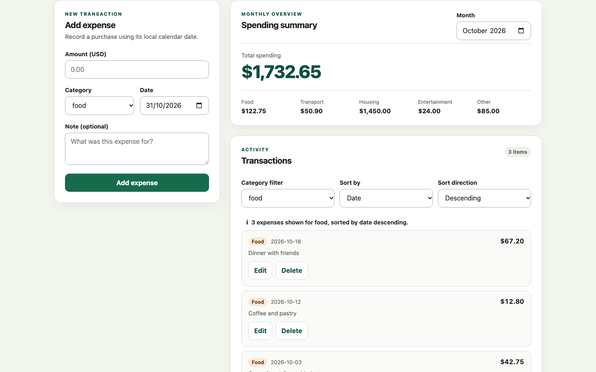

Invalid input is visible, associated with the amount field, and does not alter the summary.

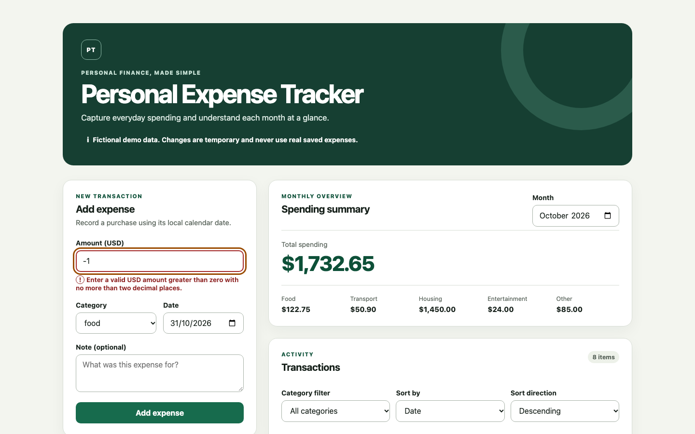

Deletion requires a native confirmation dialog with initial focus on Cancel.

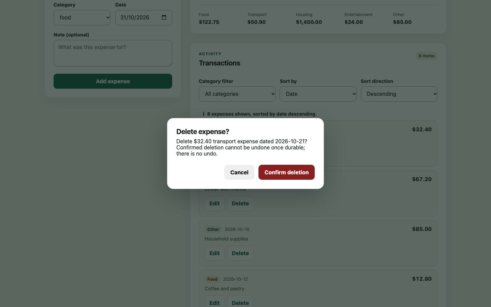

The mobile layout retains the summary and controls without horizontal overflow.

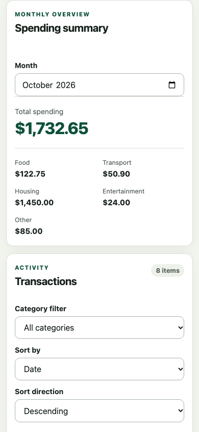

An independent production scenario also passed 12 checks covering CRUD, totals, filtering, sorting, reload persistence, keyboard submission, invalid amounts, month boundaries, malformed storage, responsive overflow, and browser console errors.

## 14. Fixing a bug through Spec Kit

The bug extension 1.0.1 was installed with:

```bash
specify extension add bug
```

For the dedicated maintenance workflow, the genuine month-clear fix was temporarily reverted so the original crash could be assessed independently. The reversion is disclosed in `evidence/bug-maintenance-reversion.md`; it is not part of the final application.

The three stages produced three reports:

```text
/speckit-bug-assess "Clearing Month crashes the app." slug=month-clear-crash
/speckit-bug-fix slug=month-clear-crash
/speckit-bug-test slug=month-clear-crash
```

- **Assessment:** valid, high severity, with matching unit and Chromium reproductions.
- **Fix:** the store guard was restored and a persistent Chromium regression added.
- **Test:** `verified`, based on the original reproduction and the full regression suite.

The final application retains the fix. The reports are under `.specify/bugs/month-clear-crash/` for inspection.

## 15. What worked, what did not, and when the process is worth using

The useful part was not document volume. It was traceability. FR-014 requires exact integer-cent arithmetic. The constitution enforces it, the money module implements it, and AMOUNT, MONEY, OVERFLOW, and SCALE cases verify it.

The test-first checkpoint also mattered. A missing-App failure established that the runner worked before implementation. The later month crash and edit race showed why generation is not the end of engineering.

Not everything went smoothly:

- the first analyzer exited without a report;
- 73 tasks needed consolidation;
- a native date input required a test-only workaround for impossible dates;
- the first full run after convergence exposed an intermittent failure;
- evidence gaps had to be corrected after initial completion claims.

A separate Copilot Chat demonstration ran `/speckit-analyze` against the frozen artifacts. Its first attempt failed because the active feature was unset. After adding `.specify/feature.json`, it reported no critical issues or constitution conflicts, while retaining open verification work.

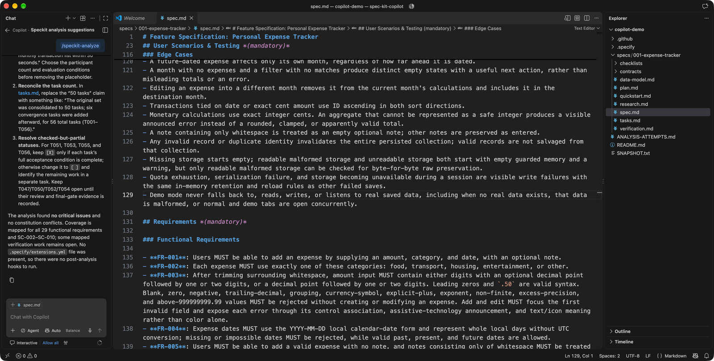

This process is worth using for financial rules, persistence recovery, accessibility, and other behavior where silent guesses are expensive. For a disposable visual prototype, the full pipeline is unnecessary. A specification and a few focused tests may be enough.

The final automated sequence passed after a clean dependency install:

- **260 unit and interaction tests** across 18 files;
- **production build** with TypeScript checking;
- **167 Chromium checks**, with one intentional mobile duplicate of the desktop browser-zoom scenario skipped;
- **zero automated axe-core violations** in the covered states;
- **zero browser console errors** in the independent production scenario.

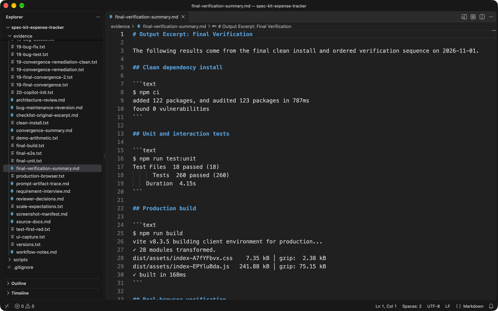

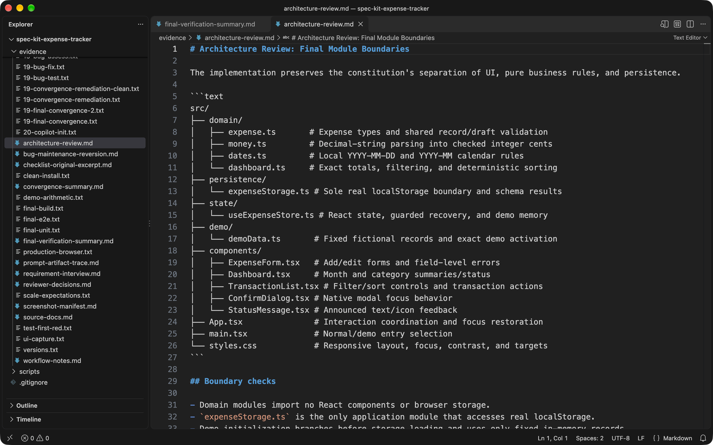

VoiceOver was not completed. Other browsers were not verified. SC-001 was not measured because no first-time-user study was conducted. These are explicit limitations, not hidden exceptions.

## 16. Reproduction instructions and source code

Clone the repository and run the application:

```bash
git clone https://github.com/hslimi/night-thoughts.git
cd night-thoughts/experiments/spec-kit-expense-tracker/app
npm ci
npx playwright install chromium
npm run dev
```

Open the URL printed by Vite and append `?demo=1` for fictional data. Normal mode uses only real localStorage data.

Run verification:

```bash
npm run test:unit
npm run build
npm run test:e2e
npx vite preview --host 127.0.0.1 --port 4173
```

The following checks connect requirements to evidence:

| Requirement                    | Verification                                                           |
| ------------------------------ | ---------------------------------------------------------------------- |
| Exact money                    | AMOUNT, MONEY, OVERFLOW, and SCALE integer-cent cases                  |
| Month boundaries               | DATE-001–004 and production adjacent-month checks                      |
| Monthly/category totals        | CORE and DEMO exact expected values                                    |
| Filtering and sorting          | FILTER, SORT, and production list checks                               |
| Persistence and malformed data | PERSIST, RECOVERY, and production reload/raw-preservation checks       |
| Deletion and keyboard focus    | DELETE and native Chromium dialog checks                               |
| Demo isolation                 | DEMO zero-read, zero-write, and zero-listener instrumentation          |
| Responsive and accessibility   | axe-core, 320px reflow, zoom, text-resize, target, and keyboard checks |
| Month-clear maintenance        | Original CORE-002 and real Chromium clear regression                   |
| Overall results                | 260 unit tests, build, 167 Chromium checks                             |

The complete source, specifications, plans, tasks, analysis, convergence reports, bug records, and sanitized evidence are available at:

**[github.com/hslimi/night-thoughts/tree/main/experiments/spec-kit-expense-tracker](https://github.com/hslimi/night-thoughts/tree/main/experiments/spec-kit-expense-tracker)**

Spec Kit’s value is not merely generating code. It makes intent, decisions, tasks, and verification visible and reviewable. Human judgement remains responsible for the result—especially when the final report contains an open gate.
